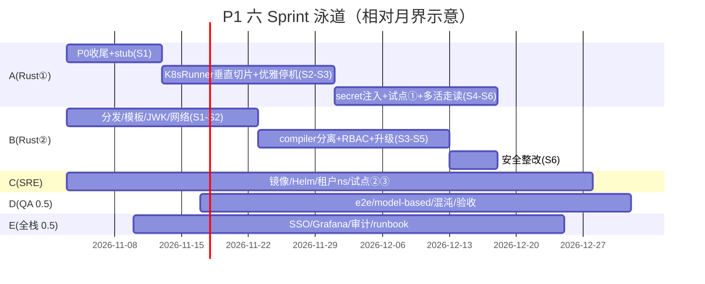

# P1（M2–M4）工单清单 —— 两周粒度 × 5 人团队

> 母文档：[self-hosted-enterprise-platform-plan.md](self-hosted-enterprise-platform-plan.md)（修订版 18–23 人月，R1 已消解）。
> P1 出口标准（母文档 §6）：3 个试点团队在 K8s 上跑非关键 pipeline；Pod 崩溃自动恢复
> RTO<2min；控制台经公司 SSO 登录；指标看板上线。
> 基线：feldera main @ v0.358.0，构建工具链 rust 1.96.1（Cargo.toml rust-version）。

## 0. 团队与负载模型

| 代号 | 角色 | 投入 | P1 主线 |
|---|---|---|---|
| A | Rust 平台① | 1.0 | K8sRunner 核心、FT 语义、secret 注入 |
| B | Rust 平台② | 1.0 | 分发/网络/模板、compiler 分离、RBAC 租户、升级 |
| C | K8s/SRE | 1.0 | 镜像流水线、Helm、租户 ns、制品供应链 |
| D | QA/SRE | 0.5 | kind e2e、model-based 状态机、混沌矩阵 |
| E | 前端/全栈 | 0.5 | SSO 登录链路、Grafana/告警、审计、runbook |

工单总量 38 张 / **≈166 人日 ≈ 7.5 人月**。名义负载：A 45d/60（75%）、B 46d/60（77%）、
C 31d/60（52%，余量为集群日常）、D 21.5d/30（72%）、E 21.5d/30（72%）。
剩余余量覆盖：上游周级发版的 rebase（P1-008 流程化）、试点救火、评审。**负载超 85% 时
砍单顺序：P1-026 → P1-031 部分 → P1-033（先出数字不设门禁）。**

**排期纪律**：每张工单单 owner（"支持"不算 owner）；DoD 即验收门禁，不满足不进
done；估算 >5 人天的必须拆；所有 anchor 指母仓库路径可直接复核。

## 1. Sprint 总览（S1–S6，双周）

| Sprint | 主题 | 出口门禁（不过即卡住下阶段） |
|---|---|---|
| S1（M2W1–2） | 地基 + P0 收尾 | stub crate 链接成功；`--enterprise` 程序本地暂停/恢复 e2e 绿；3 镜像进制品库；kind CI 骨架 |
| S2（M2W3–4） | Runner 垂直切片 | kind 上 SDK 全生命周期 e2e 绿（创建→Running→删除零残留） |
| S3（M3W1–2） | 生命周期 + 编译分离 | **Pod kill 后本地 checkpoint 自动恢复，实测 RTO<2min**；compiler StatefulSet 独立编译通过 |
| S4（M3W3–4） | 租户 + 安全 | 双租户互打不穿（配额/网络/secret 403 用例全绿）；SSO group→role 生效 |
| S5（M4W1–2） | 试点接入 + 混沌 | 试点① 2 条 pipeline 连续 1 周无 P0 事故；混沌矩阵 v1 全格有水位断言 |
| S6（M4W3–4） | 加固 + P1 出口 | §6 四条件验收演练通过；升级 rebase 彩排绿；runbook v1 |

## 2. S1（M2 上）：地基 + P0 收尾（8 张）

| ID | 工单 | 人天 | 依赖 | DoD |
|---|---|---|---|---|
| P1-001 | 两个闭源 crate 的最小 stub：新建 `crates/dbsp-enterprise`、`crates/sync-checkpoint`，后者用 `inventory::submit!` 注册本地 Noop `CheckpointSynchronizer`（4 方法：push/pull/take_ownership/list_remote，push/pull 返回明确 Unsupported 错误），避免 `checkpoint_synchronizer.rs:103` 的 expect panic | 4 | — | 编译生成的 `--enterprise` 程序链接通过；单测断言 inventory 可枚举 |
| P1-002 | `--enterprise` FT e2e v0（本机，不开 K8s）：manager 开 feature 启动 + compiler `--enterprise` 编译 datagen→http 输出 pipeline，断言 暂停→checkpoint→恢复 后水位不回退、`start_from_checkpoint` 生效（`feldera-types/src/config.rs:594-607`） | 3 | 001 | python 用例进 `python/tests/platform/`，跑绿 |
| P1-003 | rdkafka 本地/CI 环境：为 `dbsp_adapters` 全 feature 构建提供 rdkafka（优先 vendored `cmake_build`，避免 brew 依赖），固化进 CI 镜像 | 3 | — | `-p dbsp_adapters` 全 feature 编译绿（当前报 `The system library rdkafka required by crate rdkafka-sys was not found`） |
| P1-004 | 源码镜像流水线 v1：manager（`--features feldera-enterprise`，关 `postgresql_embedded`）/compiler（JDK21+Maven+cargo 工具链）/runner 三镜像，distroless 基座，版本 `<ver>-bili.N`，推内网制品库 | 6 | — | CI 出三镜像 + 三镜像 compose 起服务通过冒烟 |
| P1-005 | kind 集群 CI 骨架 + Helm chart 骨架：`controlplane`/`compiler` 两个 chart 目录、values 键名对齐官方 `helm-chart-reference.md` | 4 | 004 | CI 里 kind 安装 chart 后 manager `/healthz` 200 |
| P1-006 | K8sRunner 设计 ADR：`PipelineExecutor` trait（`crates/pipeline-manager/src/runner/pipeline_executor.rs`）到 K8s 对象的全生命周期映射表（含 `ProvisionStatus` 轮询语义、`DEFAULT_PROVISIONING_TIMEOUT`）；StatefulSet/PVC/Service/NetworkPolicy 模板与 `{id}`/`{namespace}` 占位符（`crates/feldera-types/src/config.rs:794-812`） | 4 | — | ADR 评审通过，字段映射表覆盖 trait 全部方法 |
| P1-007 | 执行器分发接线：`runner/pipeline_env.rs` 增加 `FELDERA_RUNNER=kubernetes` 选择分支 + 配置项（kubeconfig/in-cluster）；处理既有测试 `rejects_kubernetes_env_vars`（改为受控开关） | 4 | 006 | local_runner 行为零回归；新分支有单测 |
| P1-008 | 上游同步流程：`patches/` 目录约定（<2K 行）、季度 rebase 步骤、refinery 迁移只前滚守则；首次对下一个上游 tag 演练 | 2 | — | 流程文档 + 首次 rebase 记录（冲突清单与耗时） |

## 3. S2（M2 下）：Runner 垂直切片（7 张）

| ID | 工单 | 人天 | 依赖 | DoD |
|---|---|---|---|---|
| P1-009 | K8sRunner 垂直切片：`runner/k8s_runner.rs`，`kube-rs` 实现 start→创建 STS/PVC/headless Service→watch Pod Ready→`Provisioned`；RBAC/SA 最小权限（仅租户 ns 内 CRUD sts/pvc/svc/secrets） | 10 | 006,007 | kind 上真实创建 pipeline 进入 Running；单测（fake client）正常/异常路径 |
| P1-010 | manager↔runner 网络通路：headless Service 域名寻址、NetworkPolicy（仅 manager→runner 控制口、runner→数据源出向）、`FELDERA_*` 环境变量注入对齐 `pipeline_env.rs` | 6 | 009 | kind 上 manager 能拿 runner `/status`、日志流转发正常 |
| P1-011 | StatefulSet 模板渲染引擎：占位符替换、平台组覆写点、资源限额 clamp（mem 100–32000MB、storage 默认 30G/上限 128G，对齐官方 helm-chart-reference 语义） | 4 | 009 | property 测试：任意合法/越界 config → 渲染断言 clamp 生效 |
| P1-012 | 镜像供应链加固：cosign 签名 + 制品扫描（CVE gate）进 CI，未签名镜像 NetworkPolicy/准入拒绝 | 4 | 004 | 扫描报告接入；一个故意失败用例被拦 |
| P1-013 | kind e2e 套件 v1：python SDK 全生命周期（创建→部署→Running→暂停→删除），断言零资源残留（ns 内无孤儿 STS/PVC） | 4 | 009,010 | 进 CI，flaky < 1/50 |
| P1-014 | OIDC JWK 自动刷新补丁：`auth.rs` 注释明示不自动刷新 → 后台定时刷新任务 + 换 key 场景单测（upstream-first 提交社区） | 2 | — | 轮换 kid 后旧 token 拒绝/新 token 通过；PR 发上游 |
| P1-015 | Grafana v1：kind 环境采集 runner/manager `/metrics`，`deploy/grafana_dashboard.json` 改造为公司 Grafana 变量（datasource/label） | 4 | 010 | 看板可见 checkpoint 直方图（`adapters/controller.rs:1858-1864`）、背压、lag |

## 4. S3（M3 上）：生命周期 + 编译分离（6 张）

| ID | 工单 | 人天 | 依赖 | DoD |
|---|---|---|---|---|
| P1-016 | 优雅停机与恢复：Shutdown → graceful stop 触发 exit-checkpoint → STS scale 保留 PVC → start 从本地 checkpoint 恢复（checkpoint-and-resume 基础，母文档 §5.1） | 8 | 009 | e2e：暂停 10min 后恢复，输出无重无漏（at-least-once 断言，datagen 幂等键） |
| P1-017 | 删除与回收：delete 语义（PVC 保留策略参数化）、finalizer、孤儿资源 GC 扫描任务（每日对账 K8s 实况 vs PG 元数据） | 5 | 009 | 手工制造孤儿 STS/PVC 被对账发现并告警；误删防护用例 |
| P1-018 | compiler StatefulSet 分离：manager→compiler HTTP 远程编译模式跑通，PVC 20Gi 工作区，NetworkPolicy egress 仅 crates mirror + 制品库（母文档 §5.2） | 7 | 004,005 | kind 上远程编译产物 == 本地编译产物（hash 比对）；编译失败错误信息透传 |
| P1-019 | Helm 完整版：storageClass 白名单（IOPS≥16k/≥1000MB/s 盘型标签）、PVC clamp、per-tenant ns values、manager 2 副本（HA 在 P3，此间主副本行为在 values 注释标明） | 5 | 005,011 | `helm template` golden test；越界 values 被 schema 拒绝 |
| P1-020 | model-based 状态机测试：`pipeline_automata.rs` 全状态 × K8s 事件（Pod 驱逐/watch 断连/资源冲突 409/超时）注入，fake watch + kind 双后端 | 5 | 009 | 覆盖 trait 方法 × 6 类事件；发现的不一致回写 ADR |
| P1-021 | 公司 IdP 沙箱打通：console 授权码流程（对齐 `enterprise/authentication/generic-oidc.md` 模式）、`FELDERA_AUTH_CLIENT_ID/ISSUER`、HTTPS Ingress 终止（`enterprise/https.md`） | 4 | 014 | 真实 IdP 账号登录 console；⚠️ IdP 团队配合事项 S1 末就发起（外部依赖前置） |

## 5. S4（M3 下）：租户 + 安全（6 张）

| ID | 工单 | 人天 | 依赖 | DoD |
|---|---|---|---|---|
| P1-022 | 租户 ns 自动化：租户创建→namespace + ResourceQuota（cpu/mem/storage 总和）+ LimitRange 默认值，租户删除→级联回收 | 5 | 019 | 配额打满后新 pipeline 被拒且报友好错误（e2e 45s 内给出带 K8s 原始数字与下一步建议的 RunnerProvisionError，`scripts/e2e-k8s-tenant-quota.sh`）|
| P1-023 | RBAC 租户维度过滤：`api/rbac.rs` 中间件内加 tenant 过滤（deny-by-default 表不动语义，仅加谓词），tenant 由 OIDC claim / API key 归属推导 | 5 | 021 | 跨租户访问全 403 用例（含 API key 路径）；性能回归 <3% |
| P1-024 | OIDC group→role 映射：映射表配置面（fda + console 管理页）+ `oidc/trust_name.rs` 基础上的 trusted-identity 配置 | 5 | 021 | 组变更下一 token 生效；viewer/read/write/admin 四级抽查 |
| P1-025 | 连接器 secret 引用注入：pipeline 配置只允许 K8s Secret 引用（对齐官方 secret-references 特性），`kubernetesRunner.connectorKubernetesSecrets.allowlist` 白名单语义；密钥不落 PG 明文 | 5 | 009,022 | 白名单外引用被 422；PG 元数据 grep 不到密钥值 |
| P1-026 | crates 内网 mirror 接入（基础版）：sparse 代理或 vendor；sccache 共享缓存延到 P2（母文档 §5.2） | 2 | 018 | 编译 Pod 无公网 egress 也能编译成功 |
| P1-027 | 控制面审计日志：manager 访问日志（principal、route、角色判定结果）接公司日志平台（json-logging，`docs/operations/json-logging.md`）——**实测补充**：审计不在访问日志里另起一行，而是 `feldera_audit` 独立 target；`controlplane.logJson` 此前是无人读取的占位键；无凭据请求被 actix 提取器在 RBAC 之前拒掉，需外层 guard 补记 | 3 | 015 | 审计查询可按 principal 回放一次操作序列（e2e 见 `scripts/e2e-k8s-audit.sh`，Keycloak 夹具 `scripts/keycloak-fixture.sh`） |

## 6. S5（M4 上）：试点接入 + 混沌（5 张）

| ID | 工单 | 人天 | 依赖 | DoD |
|---|---|---|---|---|
| P1-028 | 混沌矩阵 v1：kill pod / 删 PVC / 断 PG / 断对象存储 / 断 Kafka 五类 × L1/L2 档位，每格断言数据水位与重复率（母文档 §8）——**实测补充**：①开源树无对象存储后端（`crates/storage/src/lib.rs:219` 只注册 `default`/`file`），「断对象存储」改为让存储目录不可写；②断 PG 时经 manager 的一切请求都失败（`check_pipeline` 先查库），断言必须直连 pod；③输入 broker 不可达时**初始化**是致命的（`refine_kafka_error` 把 connect 失败包成 fatal），已跑的 pipeline 反而不受影响；④跑出真缺陷：控制面数据库原为 `emptyDir`，pod 一换即丢 schema（见 `docs/self-hosted-chaos.md` §3.1，已修） | 5 | 016,017 | 矩阵进 CI nightly（`.github/workflows/chaos-nightly.yml`）；PG 断连期间数据面不中断得到证明（`scripts/e2e-k8s-chaos.sh` 十格全绿） |
| P1-029 | 试点团队① 接入（2 条非关键 pipeline）+ 问题修复机动 | 4 | S4 门禁 | 连续 7 天无 P0 事故；反馈→backlog |
| P1-030 | 告警基线：pipeline 非 Running、checkpoint 连续失败>3、checkpoint 年龄>3×间隔、PVC>80%、编译队列延迟、provisioning 超时（指标源 `adapter_stats.rs:512-521`） | 4 | 015 | 每类告警有注入触发用例；值班手册链接 |
| P1-031 | 升级彩排：rebase 下一上游 tag + 回归门禁首次全量（slt 子集 + `python/tests` + FT 注入 e2e + nexmark 吞吐子集） | 4 | 008,013 | 门禁脚本一键跑；升级耗时与失败清单成文 |
| P1-032 | 性能基线：同机型 本地 vs K8s PVC，验证盘型达标（16k IOPS），吞吐/恢复时间基线入库——**实测补充**：①`kubectl exec <pod> -- kill -9 1` 杀不掉 pipeline：内核不允许从 PID 命名空间内部向该命名空间的 init 进程投递 SIGKILL/SIGSTOP，命令返回 0 而进程不动（P1-028 的混沌矩阵 L2 kill-pod 格与断 PG 格因此都是空跑，已同步改为 `crash_container_of_pod` 从节点命名空间发信号），必须从**节点**命名空间发信号（kind 下 `docker exec <node> crictl inspect` 取 pid 后 `kill -9`），kubelet 才会在同一 pod 内重启容器；②删 pod 不是崩溃恢复：manager 够不到没有 pod 的 pipeline，判为失败并停机（`a_vanished_pod_stops_the_pipeline_and_records_the_error`），测到的是停机时间；③探针文件必须先顺序写满再测随机读，`ftruncate` 的稀疏文件读空洞不落盘，会测出 821573 IOPS 这种假值；④ConfigMap 走 `kubectl apply` 会因 `last-applied-configuration` 注解 256 KiB 上限被拒（base64 后 378 KiB），须用 `kubectl create`；⑤实测结论：local-path PVC 与本地目录同盘同量级（无额外开销），本机机械盘随机读 150.8/158.6 IOPS 远低于 16k，吞吐 108010 records/s，崩溃恢复 3903 ms | 2 | 019 | 基线数字进 runbook 附录（`docs/operations/performance-baseline.md` §Appendix，原始报告 `design/perf-baseline-2026-11-04.md`） |

## 7. S6（M4 下）：加固 + P1 出口（6 张）

| ID | 工单 | 人天 | 依赖 | DoD |
|---|---|---|---|---|
| P1-033 | 安全评审整改：租户互打不穿专项（网络/配额/secret/越权 403 全用例回归）、评审意见闭环——**实测补充**：四轴回归套件 `scripts/e2e-k8s-isolation.sh`（两租户、两命名空间、两配额，五条边界依次攻击，绿跑 160 s，CI `.github/workflows/test-tenant-isolation.yml`）；评审包 `design/p1-033-tenant-isolation.md`（ISO-1…ISO-9）。写套件过程中查出并修掉 4 个只有多租户才会暴露的缺陷：①**ISO-1（High，真漏洞）**`runtime_config.resources.namespace` 压过租户映射，A 可把 pipeline 放进 B 的命名空间、在 B 里解析 `${secret:kubernetes:<白名单名>/<key>}` 并经 A 自己的 connector 带走；②**ISO-8（High）** `tenantNamespaceAutomation=true` 在全新安装上根本不可用——manager 在租户命名空间建 `RoleBinding` 被 K8s 提权防护拒绝（「attempting to grant RBAC permissions not currently held」，因为它的 pipeline 权限只在 release 命名空间持有），租户创建回滚，修法是 chart 在自动化打开时多渲染一座 `ClusterRoleBinding`；③**ISO-9（High）** `manager_namespace` 回落到 *pipeline 的* 命名空间（而 `config.rs:2384` 文档写的是 runner 自己的），租户命名空间里的 NetworkPolicy 于是只放行租户、把 manager 关在门外，pipeline 起来后永远 `Unavailable`；④**ISO-7（Medium）** 配额表 key 只有 UUID 会被 runner 解析，写租户名时命名空间与配额都建好但 pipeline 仍落共享命名空间，已加启动告警。另有两条可复用事实：`requests.cpu` 配额条目会强制命名空间内每个 pod 声明 cpu request（不请求 CPU 的 pipeline 会被直接拒绝，必须配 `defaultRequest.cpu`），跨租户读按名/按 id 一律 404（行过滤先于角色检查，套件按「与不存在的名字逐字节相同」断言）。顺带修好 P1-028 之后就一直是红的 `scripts/e2e-k8s-chart.sh` golden | 4 | 022–025 | 安全团队签字，用例集进 CI |
| P1-034 | 试点②③ 接入 + 租户配额压测（互相打不穿实测）——**实测补充**：`scripts/e2e-k8s-quota-stress.sh`（三租户 `pilot-stream`/`pilot-risk`/`pilot-recsys`，各带独立 namespace + 配额 + write key，两阶段安装），绿跑 **PASS 345s**，`design/p1-034-quota-stress.md` 记录方案与结果。实测数字：onboarding 每队 2 条 pipeline 到 Running 用 31–34s；每队配额 `requests.cpu=4 / requests.memory=16Gi / persistentvolumeclaims=12 / requests.storage=48Gi / defaultRequest.cpu=100m`，2 条跑起来后 `status.used` 恰为 `cpu=2/4`、`memory=8Gi/16Gi`；再并发申请 4 条（空位 2）→ **每队恰好 2 接受 2 拒绝**，2s 采样的峰值从未越界（`cpu=4/4`、`memory=16Gi/16Gi`、`storage=24Gi/48Gi`、`pvc=6/12`）；被拒 pipeline 的 K8s 对象不出现在别的命名空间；manager 重启 0 次，拒绝后 30s 内不再有新的 pod 创建尝试（112 次尝试来自 StatefulSet 控制器退避重试，属正常）；清理后每条轴都归零。**P1-029 在本树中没有任何提交**，仓库里也没有试点团队名单，故三个团队是替身（文档 §1 写明），本单能交付的是「接入流程可从空集群走通」与「配额在并发压力下的行为」，P1-029 的七日窗口与反馈闭环不是测试能产出的。三条可复用事实：①配额条目对每个 pod 生效，`requests.cpu` 必须配 `defaultRequest.cpu`，`limits.cpu` 不该随手写；②拒绝是异步的（`POST /v0/pipelines` 返回 201，拒绝写在 `deployment_error` 里，`Stopping → Stopped` 不重试），所以「零穿透」只能在 kubectl 对象与 `resourcequota.status.used` 上断言，不能只看 HTTP 码；③StatefulSet 控制器先建 PVC 再建 pod，被拒的 pipeline 会留一个 claim（存储配额故意给宽，让这件事可见）。另记一条排障结论：**不能在 manager 背后 kubectl 删它拥有的对象**——行会永远停在 `provisioned`，stop/clear/delete 三条 API 全部永久拒绝，只能重置 DB | 4 | 029 | 3 团队在线；压测报告（配额越界零穿透） |
| P1-035 | runbook v1：部署/升级回滚/试点快速接入/故障速查（standby 留占位，P3 补）——**实测补充**：`docs/runbook.md`（725 行，英文，六节：部署 / 升级与回滚 / 接入试点 / 故障速查 / standby 占位 / 文档地图），依赖 P1-030 的是 §1.5 的监控接线（`kubernetesRunner.metrics.enabled` + `.namespace`，否则 pipeline 的 `/metrics` 抓不到）与 §4.3 的七条规则索引（`deploy/config/feldera-alerts.yml` 逐条核对，`runbook_url` 七条全部指向 `docs/operations/alerting.md#<anchor>`）。DoD 是**照着这份文档、在一个从没跑过的命名空间里独立走完一次**（release `feldera-rb` / ns `runbook` / 镜像 `p1-033`）：`helm upgrade --install --wait` **28.8s**；冷装时 API server 因 `Postgres connection pool error ... Connection refused (os error 111)` **重启 2 次**后稳住（内置 PG 与 manager 抢跑，readiness 兜住，属常态）；第一条 pipeline 的 Rust 冷编译 **4m55s**、改程序后 **<59s**；`stop/clear/delete` 三连约 40s 收干净；`pg_dump` 715 行；manager `rollout restart` **13s**，pipeline 全程 `Running Success`，`deployment_id` 与 pod UID 都不变（证明 §2.1 的「控制面重启不动数据面」）。四条写进文档的可复用事实：①**迁移单向**，refinery 默认 `abort_missing`/`abort_divergent`，降级镜像对已迁移库一定启动失败（`migration N is missing from the filesystem`），所以 `helm rollback` 单独用不是回滚，正解是先 `pg_dump`、回滚时 scale 0 → `psql -f` 恢复 → `helm rollback` → scale 1；②`program_status` 的终态是 **`Success`** 不是 `Running`（我从 `deployment_status` 类推，照 `program_status: Running` 等会永远等下去，白等两轮 25 分钟）；③**datagen 不接受 `format` 段**，示例带 format 会编译通过、启动时缩容到 0 并留 `deployment_error`；④`postgresPassword` 可省略（chart `lookup` 已有 Secret 复用、否则 `randAlphaNum 24`），而租户配额只在**启动时** `verify_at_startup` 应用，新增配额必须过一次 `helm upgrade`。初稿的两处错（datagen format、program_status 判据）连同 port-forward 的两个坑（返回后立刻 curl 是空体、多 forward 打架报 `404 Unable to find matching target resource method`）都写进 §7，供下一个改这份文档的人对照 | 4 | 030 | 新人按文档独立部署一次成功 |
| P1-036 | P1 出口验收演练：§6 四条件逐项实测（SSO 登录、Pod 崩溃 RTO<2min、看板、3 试点）——**实测补充**：演练记录 `design/p1-036-exit-rehearsal.md`（六节：四条件原文与每条隐含的问句 / 判定表 / 演练顺序与留痕 / 结果 / 缺口 / 结论），四条件全部实测而非声明：B `CELLS=kill-pod:L2` 组 **1 passed 253s**，`the view answered 1s after the crash`、`resumed at exactly 1000, the last completed checkpoint`（更大的一次是 5s，判据 120s，且 `restartCount` 变 1 证明 kill 真的打到了进程）；A `e2e-k8s-quota-stress.sh` **PASS 352s**，三队 34/35/36s 上线、每队 2 接受 2 拒绝、零穿透；C `e2e-k8s-keycloak.sh` **PASS**（发现文档→授权跳转→PKCE 换码→manager 按 owner 接受，无 token 与伪造 token 均被拒）；D `e2e-k8s-monitoring.sh` **PASS 20s**，面板自己的查询经 Grafana 数据源代理返回 `0.0299`、`grafana reads 9.0 checkpoint(s)`。四条可复用事实：①**B 格必须是 enterprise 构建**——FT 是编译期特性，OSS 镜像对带 `fault_tolerance` 的请求直接 `400 InvalidRuntimeConfig ... enterprise feature: fault tolerance`，且 `pipeline` 进程侧 `crates/connectors/src/server.rs` 有同一个 cfg 门；判据只有 `GET /v0/config` 的 `edition`（`Enterprise`/`Open source`）；仓库自己的 `deploy/build-images.sh`（`deploy/Dockerfile.manager:263` 带 `--features feldera-enterprise`）本来是对的，是我手叠的 overlay 镜像漏了特性，白跑两轮；pipeline 侧的 FT 不需要给 `cargo build --workspace` 加参数，enterprise 模式下 SQL 编译器会把它写进生成 crate 的 `Cargo.toml`；②chaos 套件的 `api_call` 用 `curl --fail`，4xx 时把 body 丢掉了，失败于是变成「无声失败」——现在 `set -E` + ERR trap 会打 `file:lineno` 和失败命令，这一条是两轮空跑的直接原因；③`histogram_quantile` 在 rate 窗口内没有样本时返回的是**空结果**而不是 NaN，读起来和「面板坏了」一模一样，套件因此在面板查询前先打一次 checkpoint 并等 `rate(..._count[1m]) > 0`；④`awk '... {print $1; exit}'` 配合 `set -o pipefail` 会让整条管道返回 141（SIGPIPE，生产者还在写），`set -e` 下静默退出且时有时无——改成读满全部输入（`!seen && ... {seen = 1}`），`e2e-k8s-chaos.sh` 两处与 `perf-baseline.sh` 一处已改。缺口清单 7 条，其中三条是「搬一次配置就到位」的替身（三试点是替身租户、SSO 是 Keycloak、看板是本命名空间的本地 Prometheus+Grafana），两条是本次暴露的真缺陷：一次 `force stop` 被接受后 reconciler 约 9 分钟无任何转场日志、重启 API server 后秒恢复（真因未定，怀疑与套件自己 `helm upgrade` 滚动 API server 有关）；`runner::reaper` 不回收 headless `pipeline-*` Service（3 天前遗留 17 个）——**2026-11-06 复跑修正**：三条套件在新镜像上重跑，`kill-pod:L2` 首次 FAIL（数据面 2s 就答上了，但 manager 报 `deployment_status: Unavailable`，原因是 `failed to lookup address information`），根因两处：headless Service 默认只发布就绪地址，pod 重启期间名字完全解析不了；以及单次传输失败就把 `desired` 也写成 `Unavailable`。已修（`render_service` 设 `publishNotReadyAddresses: true`；`parse_status_result` 容忍连续 3 次不可达、任何一次应答即清零，各配单测），**没有放宽 `scripts/e2e-k8s-chaos.sh:983` 的严格断言**；修后两次运行 237s / 245s，RTO 均 1s。教训：绿了又绿不等于对，只有换一个构建重跑才分得开。**同日整矩阵复跑**：`p1-036-fix1` 上 **10 passed, 0 failed, in 1439s**，十格各自打印的是它自己的断言而不是超时；其中 `drop-storage:L2` 的假设被证伪——只读卷下重启的那次启动写不进 `checkpoints.feldera`（`open failed: permission denied`），`/status` 回 500，manager 按致命错误停掉 pipeline，所以这一格不会自愈；脚本改为崩溃后立刻恢复卷、必要时替运维启一次，仍断言恢复点不早于最后的 checkpoint，其余九格未改，该行为写进 §5 缺口 8 | 3 | 033,034 | 演练记录 + 缺口清单归档 |
| P1-037 | automaton 多活代码走读（母文档未决问题 #2，P3 控制面 HA 选型输入）：runner automaton + `listen_table` 对多实例假设的结论 ADR | 4 | — | 走读结论进 §5.7 更新：多活可行 或 Lease 选主改造面清单 |
| P1-038 | P1 回顾 + P2 backlog 定稿（多租户收口、控制面 HA、S3 Synchronizer 正式实现排期进 P3 决策）——**实测补充**：产出 `design/p1-retrospective.md`（P1 回顾）与 `design/p2-work-orders.md`（P2 草案，12 张 / 55 人日 / 2.6 人月）两份文档。回顾从分支而不是记忆写：**38 张交付 35 张、2 张未交付、1 张即本回顾**，唯二没交付的是 P1-029（试点①七日窗口，需要另一个组织的日历）与 P1-037（automaton 多活走读，其问题已被 P1-019 的 Lease 实现 + P1-036 的 13s 接管实测回答，故撤销、决策并入 P2-004）。五条成本偏差：①**上游改名 rebase 的真实成本不在冲突里**——两边都在文件尾部追加测试时，git 把上游函数结尾的 `}` 当公共后缀吞掉，自己的函数体嵌进上游函数、冲突标记为零但编译失败，`metrics.rs`/`controller.rs`/`program.rs`/`pipeline_env.rs`/`pipeline_automata.rs`（两处）各中一次，宽口径大括号扫描 3262 个假阳性、只有编译器能判；②**enterprise 能力是 build flag 不是 entitlement**（R1 兑现方向与预想相反），但判据必须可自证：`GET /v0/config` 的 `edition` 与 `platform_version` 的 `+enterprise`；③**性能判据必须点名硬件**，16k IOPS 在机械盘上永远不达标，改口径为「同盘介质下 local-path PVC 相对本地目录无额外开销」并留 108 010 records/s 与 3903 ms 两个可比数字；④**每个 e2e 套件自己平均卡三次**（SIGPIPE 141、PID 命名空间内 kill -9 空操作、port-forward 静默失效、`python3 -` 争 stdin、`trap EXIT` 覆盖返回码、`histogram_quantile` 零 rate 返回空结果），且其中三条曾是「跑绿了但什么也没测」；⑤**平台事实比文档可信**（`program_status` 终态 `Success`、datagen 不吃 `format`、租户配额按 UUID 索引、chart 的 automation 需要配额）。七个意外缺陷（P1-033 的三个 High：命名空间逃逸、RBAC 提权自锁、manager_namespace 回落；P1-020 的卡死 Stopping、P1-019 的 failover、P1-032 的五个注入空跑、P1-036 的 force stop 停摆与 reaper 漏 Service）全部来自「机制撞上第二个租户/第二次失败/第二次构建」，单租户测试一个都没撞出来。P2 因此重切主题：不是「多租户」（前三项已被 P1 提前交付），而是**转正 + 清账 + 开门**，且自助开通（P2-007）被 P2-001 的安全评审闸住 | 1×5 | 036 | P2 工单草稿评审通过 |

> 注：P1-038 为 5 人各 1 天的复盘会，记 5 人日。合计 38 张 = 8+7+6+6+5+6。
>
> 看板同步：38 张已全部灌入 DSH 任务看板（标签 `P1-S1`…`P1-S6` 供筛选；S1 八张在「待办」，S2–S6 在 backlog；每卡描述含 owner/估算/依赖/DoD，prompt 可直接执行）。以看板为执行台账，本文档为评审基线。

## 8. 风险登记（P1 增量，接母文档 §9）

| # | 风险 | 预案 |
|---|---|---|
| R9 | IdP 团队配合排期不受控（P1-021 依赖） | S1 末发起对接工单；S2 用自建 keycloak 沙箱先行，真实 IdP 最晚 S5 切换 |
| R10 | `--enterprise` 生成程序还有未知符号依赖闭源 crate（stub 编译过 ≠ 运行全绿） | P1-002 为金丝雀：若触达 `unreachable!/expect` panic，按 panic 点补 stub 语义，最坏退路=该功能关闭配置入口（不阻塞 K8sRunner 主线） |
| R11 | kind 与生产 K8s（公司托管版）行为差异（StorageClass/网络策略实现） | P1-034 试点直接用生产集群；kind 只做快速回归层 |
| R12 | D/E 只有 0.5 投入，e2e/SSO 成为隐性瓶颈 | 砍单顺序已定；A/B 各自有一张"机动"预算（P1-029/升级期） |

## 9. 与母文档工作量对账

- K8sRunner 系（006/007/009/010/011/016/017/025）≈ 47 人日 ≈ 2.1 人月 + QA 系（013/020/028）≈ 14 人日 + 上游漂移余量 → 与母文档 5–6 人月口径一致（含返工缓冲，P1 内完成 MVP 部分，长尾进 P2）。
- Helm/镜像/CI（004/005/012/019）≈ 19 人日；编译服务（018/026）≈ 9 人日；监控（015/027/030）≈ 11 人日；SSO/多租户 P1 部分（014/021/022/023/024）≈ 21 人日；P0 收尾（001/002/003）≈ 10 人日；升级/流程（008/031/035/036/037/038）≈ 17 人日。合计 ≈166 人日 ≈ **7.5 人月**，剩余 10–15 人月分布在 P2–P4（多租户收口、控制面 HA、S3 同步 2–3、容灾演练、回填），与修订版 18–23 人月自洽。
