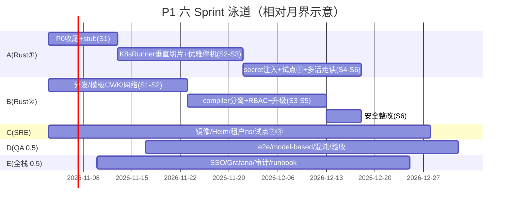

# P1（M2–M4）工单清单 —— 两周粒度 × 5 人团队

> 母文档：[self-hosted-enterprise-platform-plan.md](self-hosted-enterprise-platform-plan.md)（修订版 18–23 人月，R1 已消解）。
> P1 出口标准（母文档 §6）：3 个试点团队在 K8s 上跑非关键 pipeline；Pod 崩溃自动恢复
> RTO<2min；控制台经公司 SSO 登录；指标看板上线。
> 基线：feldera main @ v0.358.0，构建工具链 rust 1.96.1（Cargo.toml rust-version）。

## 0. 团队与负载模型

| 代号 | 角色 | 投入 | P1 主线 |
|---|---|---|---|
| A | Rust 平台① | 1.0 | K8sRunner 核心、FT 语义、secret 注入 |
| B | Rust 平台② | 1.0 | 分发/网络/模板、compiler 分离、RBAC 租户、升级 |
| C | K8s/SRE | 1.0 | 镜像流水线、Helm、租户 ns、制品供应链 |
| D | QA/SRE | 0.5 | kind e2e、model-based 状态机、混沌矩阵 |
| E | 前端/全栈 | 0.5 | SSO 登录链路、Grafana/告警、审计、runbook |

工单总量 38 张 / **≈166 人日 ≈ 7.5 人月**。名义负载：A 45d/60（75%）、B 46d/60（77%）、
C 31d/60（52%，余量为集群日常）、D 21.5d/30（72%）、E 21.5d/30（72%）。
剩余余量覆盖：上游周级发版的 rebase（P1-008 流程化）、试点救火、评审。**负载超 85% 时
砍单顺序：P1-026 → P1-031 部分 → P1-033（先出数字不设门禁）。**

**排期纪律**：每张工单单 owner（"支持"不算 owner）；DoD 即验收门禁，不满足不进
done；估算 >5 人天的必须拆；所有 anchor 指母仓库路径可直接复核。

## 1. Sprint 总览（S1–S6，双周）

| Sprint | 主题 | 出口门禁（不过即卡住下阶段） |
|---|---|---|
| S1（M2W1–2） | 地基 + P0 收尾 | stub crate 链接成功；`--enterprise` 程序本地暂停/恢复 e2e 绿；3 镜像进制品库；kind CI 骨架 |
| S2（M2W3–4） | Runner 垂直切片 | kind 上 SDK 全生命周期 e2e 绿（创建→Running→删除零残留） |
| S3（M3W1–2） | 生命周期 + 编译分离 | **Pod kill 后本地 checkpoint 自动恢复，实测 RTO<2min**；compiler StatefulSet 独立编译通过 |
| S4（M3W3–4） | 租户 + 安全 | 双租户互打不穿（配额/网络/secret 403 用例全绿）；SSO group→role 生效 |
| S5（M4W1–2） | 试点接入 + 混沌 | 试点① 2 条 pipeline 连续 1 周无 P0 事故；混沌矩阵 v1 全格有水位断言 |
| S6（M4W3–4） | 加固 + P1 出口 | §6 四条件验收演练通过；升级 rebase 彩排绿；runbook v1 |

## 2. S1（M2 上）：地基 + P0 收尾（8 张）

| ID | 工单 | 人天 | 依赖 | DoD |
|---|---|---|---|---|
| P1-001 | 两个闭源 crate 的最小 stub：新建 `crates/dbsp-enterprise`、`crates/sync-checkpoint`，后者用 `inventory::submit!` 注册本地 Noop `CheckpointSynchronizer`（4 方法：push/pull/take_ownership/list_remote，push/pull 返回明确 Unsupported 错误），避免 `checkpoint_synchronizer.rs:103` 的 expect panic | 4 | — | 编译生成的 `--enterprise` 程序链接通过；单测断言 inventory 可枚举 |
| P1-002 | `--enterprise` FT e2e v0（本机，不开 K8s）：manager 开 feature 启动 + compiler `--enterprise` 编译 datagen→http 输出 pipeline，断言 暂停→checkpoint→恢复 后水位不回退、`start_from_checkpoint` 生效（`feldera-types/src/config.rs:594-607`） | 3 | 001 | python 用例进 `python/tests/platform/`，跑绿 |
| P1-003 | rdkafka 本地/CI 环境：为 `dbsp_adapters` 全 feature 构建提供 rdkafka（优先 vendored `cmake_build`，避免 brew 依赖），固化进 CI 镜像 | 3 | — | `-p dbsp_adapters` 全 feature 编译绿（当前报 `The system library rdkafka required by crate rdkafka-sys was not found`） |
| P1-004 | 源码镜像流水线 v1：manager（`--features feldera-enterprise`，关 `postgresql_embedded`）/compiler（JDK21+Maven+cargo 工具链）/runner 三镜像，distroless 基座，版本 `<ver>-bili.N`，推内网制品库 | 6 | — | CI 出三镜像 + 三镜像 compose 起服务通过冒烟 |
| P1-005 | kind 集群 CI 骨架 + Helm chart 骨架：`controlplane`/`compiler` 两个 chart 目录、values 键名对齐官方 `helm-chart-reference.md` | 4 | 004 | CI 里 kind 安装 chart 后 manager `/healthz` 200 |
| P1-006 | K8sRunner 设计 ADR：`PipelineExecutor` trait（`crates/pipeline-manager/src/runner/pipeline_executor.rs`）到 K8s 对象的全生命周期映射表（含 `ProvisionStatus` 轮询语义、`DEFAULT_PROVISIONING_TIMEOUT`）；StatefulSet/PVC/Service/NetworkPolicy 模板与 `{id}`/`{namespace}` 占位符（`crates/feldera-types/src/config.rs:794-812`） | 4 | — | ADR 评审通过，字段映射表覆盖 trait 全部方法 |
| P1-007 | 执行器分发接线：`runner/pipeline_env.rs` 增加 `FELDERA_RUNNER=kubernetes` 选择分支 + 配置项（kubeconfig/in-cluster）；处理既有测试 `rejects_kubernetes_env_vars`（改为受控开关） | 4 | 006 | local_runner 行为零回归；新分支有单测 |
| P1-008 | 上游同步流程：`patches/` 目录约定（<2K 行）、季度 rebase 步骤、refinery 迁移只前滚守则；首次对下一个上游 tag 演练 | 2 | — | 流程文档 + 首次 rebase 记录（冲突清单与耗时） |

## 3. S2（M2 下）：Runner 垂直切片（7 张）

| ID | 工单 | 人天 | 依赖 | DoD |
|---|---|---|---|---|
| P1-009 | K8sRunner 垂直切片：`runner/k8s_runner.rs`，`kube-rs` 实现 start→创建 STS/PVC/headless Service→watch Pod Ready→`Provisioned`；RBAC/SA 最小权限（仅租户 ns 内 CRUD sts/pvc/svc/secrets） | 10 | 006,007 | kind 上真实创建 pipeline 进入 Running；单测（fake client）正常/异常路径 |
| P1-010 | manager↔runner 网络通路：headless Service 域名寻址、NetworkPolicy（仅 manager→runner 控制口、runner→数据源出向）、`FELDERA_*` 环境变量注入对齐 `pipeline_env.rs` | 6 | 009 | kind 上 manager 能拿 runner `/status`、日志流转发正常 |
| P1-011 | StatefulSet 模板渲染引擎：占位符替换、平台组覆写点、资源限额 clamp（mem 100–32000MB、storage 默认 30G/上限 128G，对齐官方 helm-chart-reference 语义） | 4 | 009 | property 测试：任意合法/越界 config → 渲染断言 clamp 生效 |
| P1-012 | 镜像供应链加固：cosign 签名 + 制品扫描（CVE gate）进 CI，未签名镜像 NetworkPolicy/准入拒绝 | 4 | 004 | 扫描报告接入；一个故意失败用例被拦 |
| P1-013 | kind e2e 套件 v1：python SDK 全生命周期（创建→部署→Running→暂停→删除），断言零资源残留（ns 内无孤儿 STS/PVC） | 4 | 009,010 | 进 CI，flaky < 1/50 |
| P1-014 | OIDC JWK 自动刷新补丁：`auth.rs` 注释明示不自动刷新 → 后台定时刷新任务 + 换 key 场景单测（upstream-first 提交社区） | 2 | — | 轮换 kid 后旧 token 拒绝/新 token 通过；PR 发上游 |
| P1-015 | Grafana v1：kind 环境采集 runner/manager `/metrics`，`deploy/grafana_dashboard.json` 改造为公司 Grafana 变量（datasource/label） | 4 | 010 | 看板可见 checkpoint 直方图（`adapters/controller.rs:1858-1864`）、背压、lag |

## 4. S3（M3 上）：生命周期 + 编译分离（6 张）

| ID | 工单 | 人天 | 依赖 | DoD |
|---|---|---|---|---|
| P1-016 | 优雅停机与恢复：Shutdown → graceful stop 触发 exit-checkpoint → STS scale 保留 PVC → start 从本地 checkpoint 恢复（checkpoint-and-resume 基础，母文档 §5.1） | 8 | 009 | e2e：暂停 10min 后恢复，输出无重无漏（at-least-once 断言，datagen 幂等键） |
| P1-017 | 删除与回收：delete 语义（PVC 保留策略参数化）、finalizer、孤儿资源 GC 扫描任务（每日对账 K8s 实况 vs PG 元数据） | 5 | 009 | 手工制造孤儿 STS/PVC 被对账发现并告警；误删防护用例 |
| P1-018 | compiler StatefulSet 分离：manager→compiler HTTP 远程编译模式跑通，PVC 20Gi 工作区，NetworkPolicy egress 仅 crates mirror + 制品库（母文档 §5.2） | 7 | 004,005 | kind 上远程编译产物 == 本地编译产物（hash 比对）；编译失败错误信息透传 |
| P1-019 | Helm 完整版：storageClass 白名单（IOPS≥16k/≥1000MB/s 盘型标签）、PVC clamp、per-tenant ns values、manager 2 副本（HA 在 P3，此间主副本行为在 values 注释标明） | 5 | 005,011 | `helm template` golden test；越界 values 被 schema 拒绝 |
| P1-020 | model-based 状态机测试：`pipeline_automata.rs` 全状态 × K8s 事件（Pod 驱逐/watch 断连/资源冲突 409/超时）注入，fake watch + kind 双后端 | 5 | 009 | 覆盖 trait 方法 × 6 类事件；发现的不一致回写 ADR |
| P1-021 | 公司 IdP 沙箱打通：console 授权码流程（对齐 `enterprise/authentication/generic-oidc.md` 模式）、`FELDERA_AUTH_CLIENT_ID/ISSUER`、HTTPS Ingress 终止（`enterprise/https.md`） | 4 | 014 | 真实 IdP 账号登录 console；⚠️ IdP 团队配合事项 S1 末就发起（外部依赖前置） |

## 5. S4（M3 下）：租户 + 安全（6 张）

| ID | 工单 | 人天 | 依赖 | DoD |
|---|---|---|---|---|
| P1-022 | 租户 ns 自动化：租户创建→namespace + ResourceQuota（cpu/mem/storage 总和）+ LimitRange 默认值，租户删除→级联回收 | 5 | 019 | 配额打满后新 pipeline 被拒且报友好错误（e2e 45s 内给出带 K8s 原始数字与下一步建议的 RunnerProvisionError，`scripts/e2e-k8s-tenant-quota.sh`）|
| P1-023 | RBAC 租户维度过滤：`api/rbac.rs` 中间件内加 tenant 过滤（deny-by-default 表不动语义，仅加谓词），tenant 由 OIDC claim / API key 归属推导 | 5 | 021 | 跨租户访问全 403 用例（含 API key 路径）；性能回归 <3% |
| P1-024 | OIDC group→role 映射：映射表配置面（fda + console 管理页）+ `oidc/trust_name.rs` 基础上的 trusted-identity 配置 | 5 | 021 | 组变更下一 token 生效；viewer/read/write/admin 四级抽查 |
| P1-025 | 连接器 secret 引用注入：pipeline 配置只允许 K8s Secret 引用（对齐官方 secret-references 特性），`kubernetesRunner.connectorKubernetesSecrets.allowlist` 白名单语义；密钥不落 PG 明文 | 5 | 009,022 | 白名单外引用被 422；PG 元数据 grep 不到密钥值 |
| P1-026 | crates 内网 mirror 接入（基础版）：sparse 代理或 vendor；sccache 共享缓存延到 P2（母文档 §5.2） | 2 | 018 | 编译 Pod 无公网 egress 也能编译成功 |
| P1-027 | 控制面审计日志：manager 访问日志（principal、route、角色判定结果）接公司日志平台（json-logging，`docs/operations/json-logging.md`）——**实测补充**：审计不在访问日志里另起一行，而是 `feldera_audit` 独立 target；`controlplane.logJson` 此前是无人读取的占位键；无凭据请求被 actix 提取器在 RBAC 之前拒掉，需外层 guard 补记 | 3 | 015 | 审计查询可按 principal 回放一次操作序列（e2e 见 `scripts/e2e-k8s-audit.sh`，Keycloak 夹具 `scripts/keycloak-fixture.sh`） |

## 6. S5（M4 上）：试点接入 + 混沌（5 张）

| ID | 工单 | 人天 | 依赖 | DoD |
|---|---|---|---|---|
| P1-028 | 混沌矩阵 v1：kill pod / 删 PVC / 断 PG / 断对象存储 / 断 Kafka 五类 × L1/L2 档位，每格断言数据水位与重复率（母文档 §8） | 5 | 016,017 | 矩阵进 CI nightly；PG 断连期间数据面不中断得到证明 |
| P1-029 | 试点团队① 接入（2 条非关键 pipeline）+ 问题修复机动 | 4 | S4 门禁 | 连续 7 天无 P0 事故；反馈→backlog |
| P1-030 | 告警基线：pipeline 非 Running、checkpoint 连续失败>3、checkpoint 年龄>3×间隔、PVC>80%、编译队列延迟、provisioning 超时（指标源 `adapter_stats.rs:512-521`） | 4 | 015 | 每类告警有注入触发用例；值班手册链接 |
| P1-031 | 升级彩排：rebase 下一上游 tag + 回归门禁首次全量（slt 子集 + `python/tests` + FT 注入 e2e + nexmark 吞吐子集） | 4 | 008,013 | 门禁脚本一键跑；升级耗时与失败清单成文 |
| P1-032 | 性能基线：同机型 本地 vs K8s PVC，验证盘型达标（16k IOPS），吞吐/恢复时间基线入库 | 2 | 019 | 基线数字进 runbook 附录 |

## 7. S6（M4 下）：加固 + P1 出口（6 张）

| ID | 工单 | 人天 | 依赖 | DoD |
|---|---|---|---|---|
| P1-033 | 安全评审整改：租户互打不穿专项（网络/配额/secret/越权 403 全用例回归）、评审意见闭环 | 4 | 022–025 | 安全团队签字，用例集进 CI |
| P1-034 | 试点②③ 接入 + 租户配额压测（互相打不穿实测） | 4 | 029 | 3 团队在线；压测报告（配额越界零穿透） |
| P1-035 | runbook v1：部署/升级回滚/试点快速接入/故障速查（standby 留占位，P3 补） | 4 | 030 | 新人按文档独立部署一次成功 |
| P1-036 | P1 出口验收演练：§6 四条件逐项实测（SSO 登录、Pod 崩溃 RTO<2min、看板、3 试点） | 3 | 033,034 | 演练记录 + 缺口清单归档 |
| P1-037 | automaton 多活代码走读（母文档未决问题 #2，P3 控制面 HA 选型输入）：runner automaton + `listen_table` 对多实例假设的结论 ADR | 4 | — | 走读结论进 §5.7 更新：多活可行 或 Lease 选主改造面清单 |
| P1-038 | P1 回顾 + P2 backlog 定稿（多租户收口、控制面 HA、S3 Synchronizer 正式实现排期进 P3 决策） | 1×5 | 036 | P2 工单草稿评审通过 |

> 注：P1-038 为 5 人各 1 天的复盘会，记 5 人日。合计 38 张 = 8+7+6+6+5+6。
>
> 看板同步：38 张已全部灌入 DSH 任务看板（标签 `P1-S1`…`P1-S6` 供筛选；S1 八张在「待办」，S2–S6 在 backlog；每卡描述含 owner/估算/依赖/DoD，prompt 可直接执行）。以看板为执行台账，本文档为评审基线。

## 8. 风险登记（P1 增量，接母文档 §9）

| # | 风险 | 预案 |
|---|---|---|
| R9 | IdP 团队配合排期不受控（P1-021 依赖） | S1 末发起对接工单；S2 用自建 keycloak 沙箱先行，真实 IdP 最晚 S5 切换 |
| R10 | `--enterprise` 生成程序还有未知符号依赖闭源 crate（stub 编译过 ≠ 运行全绿） | P1-002 为金丝雀：若触达 `unreachable!/expect` panic，按 panic 点补 stub 语义，最坏退路=该功能关闭配置入口（不阻塞 K8sRunner 主线） |
| R11 | kind 与生产 K8s（公司托管版）行为差异（StorageClass/网络策略实现） | P1-034 试点直接用生产集群；kind 只做快速回归层 |
| R12 | D/E 只有 0.5 投入，e2e/SSO 成为隐性瓶颈 | 砍单顺序已定；A/B 各自有一张"机动"预算（P1-029/升级期） |

## 9. 与母文档工作量对账

- K8sRunner 系（006/007/009/010/011/016/017/025）≈ 47 人日 ≈ 2.1 人月 + QA 系（013/020/028）≈ 14 人日 + 上游漂移余量 → 与母文档 5–6 人月口径一致（含返工缓冲，P1 内完成 MVP 部分，长尾进 P2）。
- Helm/镜像/CI（004/005/012/019）≈ 19 人日；编译服务（018/026）≈ 9 人日；监控（015/027/030）≈ 11 人日；SSO/多租户 P1 部分（014/021/022/023/024）≈ 21 人日；P0 收尾（001/002/003）≈ 10 人日；升级/流程（008/031/035/036/037/038）≈ 17 人日。合计 ≈166 人日 ≈ **7.5 人月**，剩余 10–15 人月分布在 P2–P4（多租户收口、控制面 HA、S3 同步 2–3、容灾演练、回填），与修订版 18–23 人月自洽。
