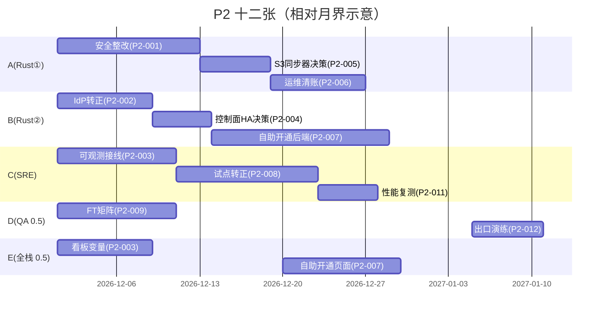

# P2（M6–M7）工单清单草案 —— 两周粒度 × 5 人团队

> 母文档：[self-hosted-enterprise-platform-plan.md](self-hosted-enterprise-platform-plan.md)（§5、§6 P2、§11 未决问题）。
> P1 回顾：[p1-retrospective.md](p1-retrospective.md)（38 张工单的交付对照、五条成本偏差、七个意外缺陷）。
> **P2 出口标准（母文档 §6）**：租户配额压测（互相打不穿）；secret 白名单越权用例全部 403；
> 安全评审通过 → 开放生产关键路径之外的**自助开通**。
> 基线：`p1-rebased-onto-main` @ `d9a6115e8`（63 提交，P1 出口演练通过）。

## 0. 为什么 P2 不是原计划的 P2

母文档写 P2 时（M6–M7：namespace/配额/secret 白名单、group→role + 审计 + JWK 刷新、
安全评审 + 渗透），这四件事里前三件**已经在 P1 提前交付**——因为每个机制只有撞上第二个
租户、第二次失败、第二次构建时才成立，做不了「先写代码、P2 再验证」：

| 母文档 P2 原项 | P1 后的实际 | 本清单对应 |
|---|---|---|
| namespace / 配额 / secret 白名单 | 已交付（P1-022 / P1-025 / P1-033 / P1-034），零穿透实测 | — |
| group → role + 审计 + JWK 刷新 | 已交付（P1-024 / P1-027 / P1-014） | P2-002 转正 |
| 安全评审 + 渗透 | 评审包已写（`design/p1-033-tenant-isolation.md`），**外部评审未做** | P2-001 |
| 自助开通 | **未开工** | P2-007 |
| （新）三个替身转正 | 三试点是替身租户、SSO 是 Keycloak、看板是本地 Prometheus | P2-002 / P2-003 / P2-008 |
| （新）P1 暴露未修 | force stop 停摆、reaper 漏 Service、chaos 套件缺预检 | P2-006 |

所以 P2 的主题从「多租户」改成**「转正 + 清账 + 开门」**：把三个替身换成真的，把 P1
发现的缺陷修掉，然后才允许自助开通。

## 1. 团队与负载模型

| 代号 | 角色 | 投入 | P2 主线 |
|---|---|---|---|
| A | Rust 平台① | 1.0 | 安全整改、S3 synchronizer 决策、运维缺口 |
| B | Rust 平台② | 1.0 | IdP 转正、HA 决策、自助开通后端 |
| C | K8s/SRE | 1.0 | 可观测接线、试点转正、性能复测 |
| D | QA/SRE | 0.5 | 渗透配合、FT 矩阵、出口演练 |
| E | 前端/全栈 | 0.5 | 自助开通管理页、Grafana 变量、告警联调 |

工单总量 12 张 / **≈55 人日 ≈ 2.6 人月**。M6–M7 两个月的名义容量约 100 人日，余量
（约 45 人日）留给试点救火、上游周级 rebase、以及安全评审来回。

**排期纪律（沿用 P1）**：每张单一个 owner；DoD 即门禁；估算 >5 人天必须拆；anchor 指
母仓库路径可直接复核。**门外单**：P2-007（自助开通）必须等 P2-001 通过后才开工，
这是母文档 §6 的出口语义，不是排期偏好。

## 2. Sprint 总览（P2-S1 / P2-S2，各约一个月）

| Sprint | 主题 | 出口门禁 |
|---|---|---|
| P2-S1（M6） | 转正 + 决策 + 清账 | 公司 IdP 登录全链路绿；公司监控栈看到看板与告警；HA 与 S3 两个 ADR 通过；P1 遗留缺陷全部有结论 |
| P2-S2（M7） | 开门 | 外部安全评审通过；一个真实团队**自助**开通到 Running；三试点连续 7 天无 P0；P2 出口演练绿 |

## 3. P2-S1（M6）：转正 + 决策 + 清账（6 张）

| ID | 工单 | 人天 | 依赖 | DoD |
|---|---|---|---|---|
| P2-001 | **外部安全评审 + 渗透测试**：以 `design/p1-033-tenant-isolation.md` 为输入（四轴威胁模型、ISO-1…ISO-9、已接受风险清单），出评审范围与材料包，跟进整改与复测 | 8 | P1-033 | 评审报告归档；无 High 未修复项；中危项全部有结论（修 / 接受并写进 §5 已接受风险） |
| P2-002 | **公司 IdP 转正**：在真实 IdP 注册 client（`FELDERA_AUTH_CLIENT_ID`/`ISSUER`/`audience`），跑通 console 授权码流程；明确 group claim 容量与角色映射治理归口（母文档未决 #3） | 4 | P1-021, P1-024 | `scripts/e2e-k8s-keycloak.sh` 的流程在公司 IdP 上复跑通过；group→role 生效；治理归口有书面 owner |
| P2-003 | **可观测接公司栈**：Prometheus 改远端写 / ServiceMonitor 接入、`deploy/grafana_dashboard.json` 变量化后进公司 Grafana、七条告警规则接公司告警平台（值班路由） | 5 | P1-030, P1-015 | 公司 Grafana 上看到 `dbsp` 看板且有数；演练一条告警落到值班；runbook §4.3 的链接改指公司地址 |
| P2-004 | **控制面 HA 决策 ADR**：以 P1-036 的实测（API server 重启 13s、pipeline 全程不动、`deployment_id` 与 pod UID 不变）为输入，在「Lease 温备」与「多活」之间定案，产出 P3 排期 | 3 | P1-019, P1-036 | ADR 通过；P3 工单已排（含主副本 kill 后 30s 接管的验收口径） |
| P2-005 | **S3 Synchronizer 决策 + 原型范围**：当前只有 `crates/sync-checkpoint` 的 `LocalDirSynchronizer`；L4 DR 需要 S3 兼容实现，决定自研还是等上游 | 4 | P1-001, P1-002 | ADR（自研 / 等上游 / 外部实现）+ P3 工单草案；原型范围与工作量明确 |
| P2-006 | **运维缺口清账**：①`runner::reaper` 不回收孤儿 headless Service（3 天遗留 17 个）；②`force stop` 被接受后 reconciler 约 9 分钟无动作（重启 API server 恢复，真因未定）；③`e2e-k8s-chaos.sh` 缺 enterprise 预检、`api_call` 4xx 丢 body；④`webconsole-dist/` 纳入镜像门禁定期重建 | 5 | P1-036 | ①②各有结论（修复或立项说明）；③进套件；④有脚本步骤 |

## 4. P2-S2（M7）：开门（6 张）

| ID | 工单 | 人天 | 依赖 | DoD |
|---|---|---|---|---|
| P2-007 | **租户自助开通**：tenants API 自助创建、配额申请与审批流、console 管理页、onboarding 文档（从 `docs/runbook.md` §3 提炼） | 8 | P2-001, P2-002 | 一个没参与过平台的团队自助开通到 pipeline `Running Success`，全程无平台同学介入；配额超额走审批而不是 500 |
| P2-008 | **三试点转正**：把 `pilot-stream`/`pilot-risk`/`pilot-recsys` 换成三个真实团队的 pipeline，连续 7 天观察 + 反馈闭环（P1-029 结转） | 5 | P2-003 | 三个真实团队在跑；7 天无 P0 事故；反馈逐条进 backlog |
| P2-009 | **连接器 FT 支持矩阵 + 回填 playbook**：哪些源/汇满足 exactly-once 前置（Kafka 之外多为 at-least-once）、L5 回填的触发与操作 | 4 | P1-028 | 矩阵文档租户可见；按 playbook 演练一次回填并留记录 |
| P2-010 | **上游同步常态化**：每上游 tag 跑一次 `scripts/post-rebase-gates.sh`（rebase-check 档），季度跑 release 档；`webconsole-dist` 重建纳入 gate 5 | 3 | P1-008, P1-031 | 连续两个 tag 的 rebase 记录归档；gate 报告进 `design/rebase-gates-<date>-<sha>.md` |
| P2-011 | **性能口径复测**：在真实目标盘型上重跑 `scripts/perf-baseline.sh`，与 P1 机械盘基线（150/158 IOPS 随机读、878/961 MiB/s 顺序、108 010 records/s）并置，给「16k IOPS」判据一个真实答案 | 3 | P1-032 | 两组数字并列入 `docs/operations/performance-baseline.md`；不达标则写清是盘型还是平台 |
| P2-012 | **P2 出口演练**：§6 三条件逐项实测（配额压测零穿透、dev key 越权全 403、安全评审通过），格式照 `design/p1-036-exit-rehearsal.md` | 3 | P2-001, P2-007, P2-008 | 三条件各有数字；缺口清单归档；据此决定是否开放自助开通 |

## 5. 风险登记（P2 增量）

| ID | 风险 | 触发信号 | 预案 |
|---|---|---|---|
| R1 | 外部安全评审排期落不进 M7（外部团队日历） | 评审范围确认晚于 P2-S2 起点 | P2-012 只对「评审已通过」下结论，不替评审背书；如实写进缺口清单 |
| R2 | 公司 IdP 的 group claim 粒度不够，角色映射只能到「全体同权」 | P2-002 联调时 claim 里没有可用分组 | 退回 trusted-identity 配置（`oidc/trust_name.rs`）+ 审批制，写进 P2-007 的准入 |
| R3 | 自助开通成为配额滥用的入口 | 开通后一周内出现无人认领的 pipeline | 配额审批 + 默认小配额 + 闲置回收（复用 reaper）；P2-007 必带 |
| R4 | 公司监控栈的抓取模型与 pipeline Service 不兼容（多租户命名空间） | P2-003 接线时抓不到 tenant ns 的目标 | 退化为 manager 汇总指标 + 每租户一 ServiceMonitor；在 ADR 里记 |
| R5 | P1 遗留的 force stop 停摆在自助开通后变成用户可见故障 | P2-006 复现不出来 | 保持「重启 API server 可恢复」的 runbook 条目，并在 P2-006 给出监控（stop 超过 2 分钟告警） |

## 6. 与母文档工作量对账

| 工作流 | 母文档 P2 估算 | 本清单 | 差异原因 |
|---|---|---|---|
| 多租户收口 | 2 人月 | 0（P1 已交付） | 提前到 P1，见 §0 |
| group→role + 审计 + JWK | 1 人月 | 0.2 人月（转正） | 同上 |
| 安全评审 + 渗透 | 1 人月 | 0.4 人月（内部配合） | 外部评审人力不计入团队 |
| 自助开通 | 未估 | 0.4 人月 | 母文档写在出口条件里但没估工作量 |
| 转正 + 清账 + 决策（新增） | — | 1.6 人月 | P1 暴露的缺口与三个替身 |

合计 **≈2.6 人月**，与母文档 P2 的 4 人月相比少 1.4，差额是 P1 提前交付的部分；
本清单把省下的余量留在 M7，用于评审往返与试点救火。

> P1 结转：P1-029（试点①七日窗口）→ P2-008；P1-037（automaton 多活走读）→ **撤销**，
> 其问题已由 P1-019 的 Lease 实现与 P1-036 的 13s 接管实测回答，剩余决策归 P2-004。
