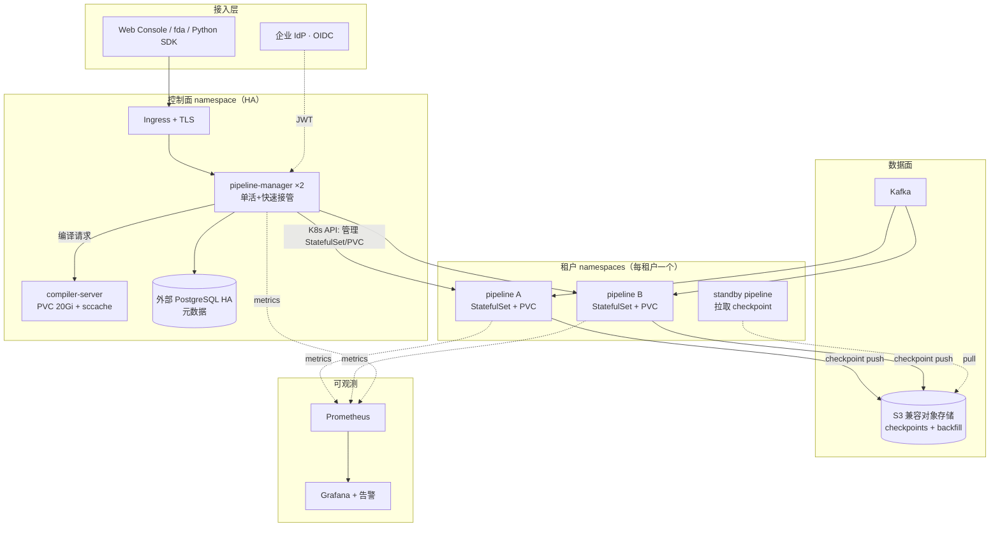
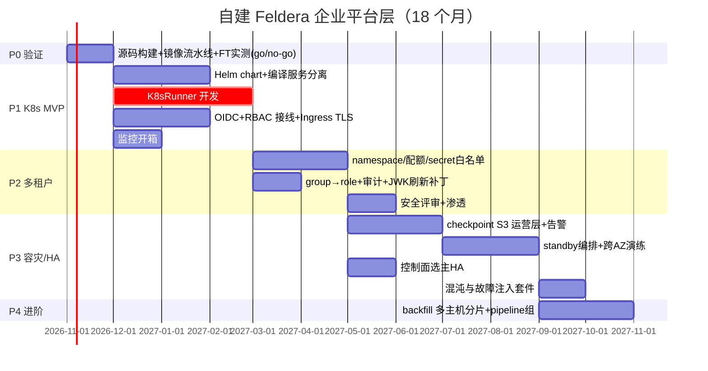

# 基于开源 Feldera 自建企业平台层 —— 技术方案与里程碑排期

> 基线：feldera main @ 2ad179e05（v0.358.0），2026-10。
> 作者备注：本文所有"已有/缺失"判断均以本仓库源码为准，路径可点击复核。

---

## 1. 目标与非目标

**目标**：在自有 K8s 集群上提供 Feldera Enterprise 等价的生产能力——多节点部署、
per-pipeline 资源隔离与多租户、企业 SSO/RBAC/secrets、pipeline 容错与跨可用区/区域
容灾、开箱监控——不依赖 Feldera license，数据不出内网。

**非目标**（明确砍掉）：
- 单 pipeline 跨节点在线 scale-out（官方 Enterprise 亦标注 coming soon，属研究前沿；
  用"多 pipeline 水平分摊 + 回填加速"替代，见 §5.6/§9）。
- License/计费体系（自托管不需要）。
- 私有镜像仓与私有 cargo registry 之外的供应链体系（复用公司现有制品库）。

---

## 2. 既有资产盘点（决定排期的事实）

### 2.1 开源仓库里已经有（不需要做）

| 资产 | 位置 | 说明 |
|---|---|---|
| 增量计算引擎 DBSP | `crates/dbsp/`（~17.7 万行 Rust） | 含 file-backed trace（大于内存）、spine_async |
| SQL 编译器 | `sql-to-dbsp-compiler/`（~20.3 万行 Java, Calcite） | 全量 SQL 增量改写 |
| 全部连接器 | `crates/adapters/`（~11.8 万行） | Kafka/S3/HTTP/JDBC/Postgres CDC/Iceberg/datagen… |
| 控制面 | `crates/pipeline-manager/`（~6.2 万行） | REST API、PG 元数据（refinery 迁移）、pipeline 状态机、日志流 |
| **OIDC 认证** | `crates/pipeline-manager/src/auth.rs`、`src/oidc/` | JWT 校验（Cognito/Okta/Google/通用 OIDC）、JWK 缓存、API keys（DB 存哈希） |
| **RBAC** | `crates/pipeline-manager/src/api/rbac.rs` | deny-by-default 路由表，角色 read<write<admin<owner |
| **容错 checkpoint 运行时** | `crates/dbsp/src/circuit/checkpointer.rs`、`crates/adapters/src/controller/checkpoint.rs`、`crates/adapters/src/transport/kafka/ft/` | checkpoint/恢复、Kafka exactly-once（offset 对齐 + journaling） |
| **S3 checkpoint 同步** | `crates/storage/src/checkpoint_synchronizer.rs`、`crates/dbsp/tests/checkpoint_sync.rs` | push/pull、bucket 独占（standby 前提）、IRSA/rclone env（`crates/feldera-types/src/config.rs:583-594`）、`start_from_checkpoint`（config.rs:594-607）、standby 模式（config.rs:657） |
| Runner 可插拔接口 | `crates/pipeline-manager/src/runner/pipeline_executor.rs` | `PipelineExecutor` trait：`ProvisionStatus`/`new`/生命周期方法，专为多执行器设计 |
| K8s StatefulSet 模板设计文档 | `crates/feldera-types/src/config.rs:794-812` | 官方企业版 K8sRunner 的模板语义（`{id}`/`{namespace}` 占位符）已写进开源类型注释 |
| 可观测性 | `crates/feldera-observability/`、`deploy/grafana_dashboard.json` | OTel tracing、Prometheus 指标（含 checkpoint push/pull 耗时直方图，adapters/controller.rs:1858-1864） |
| 前端/SDK | `js-packages/web-console/`、`python/`、`crates/fda/`、`openapi.json` | 控制台、CLI、Python SDK、REST 规范 |
| 企业架构参考 | `docs.feldera.com/docs/get-started/enterprise/`（helm-guide + helm-chart-reference + authentication/*） | 官方企业版全部组件形态、Helm values、PG/TLS/资源限额/auth 集成方式公开 |

**关键核验结论**：
1. `grep -rni "license|entitlement" crates/{dbsp,adapters,storage}/src` 未发现运行时
   license 门控——checkpoint/S3 同步代码在 MIT 源码中完整存在。docs 标
   "Enterprise-only" 更可能指官方发行镜像/云服务的 entitlement；**从源码构建的
   镜像大概率可直接启用 FT**。→ 排期里 Phase 0 的首要任务就是实测证实这一点
   （go/no-go 风险项，见 §9 R1）。
2. 控制面元数据本来就在 PostgreSQL（`storage_postgres.rs`），单容器里的
   embedded PG（`postgresql_embedded` feature）只是 Docker demo 形态。
3. OSS 唯一 runner 是 `local_runner.rs`（子进程 + supervisor 重启）；
   **K8sRunner（StatefulSet 编排）是闭源的**（pipeline-manager 无 `kube` 依赖，
   `pipeline_env.rs:69` 的测试名 `rejects_kubernetes_env_vars` 反向印证），
   这是自研主体。

### 2.2 需要自研/自建的（缺口清单）

| # | 缺口 | 性质 |
|---|---|---|
| G1 | KubernetesRunner（`PipelineExecutor` 的 K8s 实现） | 核心开发 |
| G2 | Helm chart + 生产镜像流水线（源码构建） | 工程 |
| G3 | 编译服务独立化（compiler Deployment + sccache 共享缓存 + 私仓） | 工程 |
| G4 | 多租户：per-tenant namespace、配额、secret 白名单、OIDC group→role 映射、审计 | 开发+策略 |
| G5 | 容灾运营层：checkpoint 生命周期、standby 编排、RPO/RTO 监控告警、演练 | 工程（运行时已有） |
| G6 | 控制面高可用（多副本语义确认或选主改造） | 开发 |
| G7 | 监控开箱：Prometheus 采集、Grafana、告警规则、日志（json-logging） | 工程 |
| G8 | 升级/上游同步策略（Feldera 发版节奏 ~周级） | 流程 |

---

## 3. 目标架构

与官方企业版的组件对应关系：`pipeline-manager`（我们部署 2 副本，选主策略见
§5.7）、compiler-server、kubernetes runner（我们自研 G1）、外部 PG、对象存储。
差异：不自建 license 校验；standby 用 pipeline + checkpoint-sync 原生能力组合。

---

## 4. 镜像与制品（G2）

- **全部镜像从源码构建**（既规避企业镜像可能的 entitlement 门控，又满足供应链）：
  - `pipeline-manager`：`cargo build --release -p pipeline-manager`（关
    `postgresql_embedded` feature，强制外部 PG）。
  - `runner` 镜像 = 同镜像携带运行时依赖（Java 21 供编译产物加载 sqllib 不需要，
    runner 仅 Rust 二进制 + 动态链接库），基础镜像用 distroless。
  - `compiler` 镜像：JDK + Maven（Calcite）+ cargo 工具链，按
    `docs.feldera.com/docs/get-started/enterprise/parallel-compilation.md` 与
    `private-cargo-registry.md` 配置内网 crates 镜像。
- 版本策略：跟随上游 tag（周级），打我们自己的 semver 后缀 `-bili.N`；
  每次升级跑 §8 的回归门禁。
- Helm chart 结构：`controlplane`（Deployment×2 + Service + HPA 不需要，选主）+
  `compiler`（StatefulSet，PVC 20Gi）+ 可选 `postgres`（仅测试环境）+ RBAC/SA +
  NetworkPolicy；values 直接对齐官方 `helm-chart-reference.md` 的键名，
  减少认知差与未来迁移成本。

## 5. 分域详细设计

### 5.1 KubernetesRunner（G1，核心）

**接口**：实现 `runner/pipeline_executor.rs::PipelineExecutor`
（`fn new(...) / ProvisionStatus / start / stop / delete / ...`），在
`pipeline_env.rs` 的执行器选择处分发到新模块 `runner/k8s_runner.rs`。

**每个 pipeline 的资源对象**（对齐官方 helm-chart-reference 语义）：
- `StatefulSet`（单副本）：runner 二进制 + 挂载 PVC；`{id}`/`{namespace}` 占位符
  模板按 `feldera-types/src/config.rs:794-812` 实现，允许平台组覆写模板。
- `PVC`：容量 = pipeline 配置 `storage_mb`，clamp 到集群 [lowerLimit, upperLimit]
  （官方默认 30 GiB / 上限 128 GiB，IOPS≥16k / ≥1000MB/s 的盘型要求写进
  StorageClass 白名单）。
- `Service`（headless）+ NetworkPolicy：只允许 manager→runner 控制端口与
  runner→出向数据源。
- Secrets 注入：连接器凭据只允许引用 K8s Secret 引用（secret-references 特性），
  白名单机制按 `kubernetesRunner.connectorKubernetesSecrets.allowlist` 语义实现。

**生命周期映射**：`pipeline_automata.rs` 状态机 → K8s 动作
（Provisioning=创建 STS/PVC 并等待 Pod Ready，超时 `DEFAULT_PROVISIONING_TIMEOUT`；
Running=就绪探针 + 指标端口可达；Shutdown=graceful stop 触发
"checkpoint on exit"，即 checkpoint-and-resume 模式的基础）。

**崩溃语义**：Pod 崩溃 → StatefulSet 重建 → runner 从本地 checkpoint 恢复
（FT 开启时，无需 runner 端额外逻辑，这是把 local_runner 的 supervisor 职责下沉给
K8s，`local_runner.rs:69/231` 的注释已预告此设计）。

**体量评估**：接口窄、语义清晰、有官方模板文档 → 2 名 Rust × 2.5–3 个月（含测试：
kind/eval 集群 e2e + 状态机 model-based test）。

### 5.2 编译服务（G3）

- compiler 与 manager 分离：manager 通过 HTTP 调 compiler（OSS 已有编译子命令结构），
  compiler StatefulSet + 共享 PVC + sccache（并行编译文档路线），后端接内网 crates
  mirror（vendoring 或 sparse index 代理）。
- 编译画像：默认 `optimized`；开发租户提供 `debug` 画像加快迭代。
- 出网控制：编译 Pod 仅允许访问 crates mirror + 制品库（NetworkPolicy egress）。

### 5.3 多租户与隔离（G4）

- **租户模型**：1 租户 = 1 K8s namespace（`enablePerPipelineNamespace` 的简化形态，
  pipeline 与其 PVC 都落在租户 ns）；manager 侧给 pipeline 元数据加 tenant 标签
  （经 OIDC claim 或 API key 归属推导，RBAC 表已有角色，补 tenant 维度过滤在
  `api/rbac.rs` 中间件内做，改动集中）。
- **配额**：Namespace ResourceQuota（cpu/mem/storage 总和）+ LimitRange 默认值；
  与 pipeline 级 `resources` clamp 双层校验，防绕过。
- **身份→角色**：OIDC group claim → `Role`（admin/developer(read/write)/viewer），
  映射表由平台管理员配置；`oidc/trust_name.rs` 已有 trusted-identity 基础，
  service-to-service 走 API key。
- **审计**：manager 访问日志（含 principal、route、角色判定结果）落公司日志平台；
  PG 行级不扩展——控制面审计够用即可。

### 5.4 SSO（复用 OSS auth.rs）

- 对接公司统一 IdP（OIDC）：配置 `FELDERA_AUTH_CLIENT_ID`/`FELDERA_AUTH_ISSUER`，
  验证 iss/aud/exp/签名，JWK 缓存。已知缺陷：JWK 不自动刷新（auth.rs 注释明示）→
  补后台刷新任务（1 人周）+ 单测。
- Web Console 登录链路：console 直接走 IdP 授权码流程拿 JWT（企业文档
  authentication/generic-oidc.md 即此模式）；HTTPS 必需（Ingress 终止或 passthrough，
  按 `enterprise/https.md`）。
- API keys 供 SDK/CI 使用，128 随机字符、DB 只存哈希（auth.rs 文档），沿用。

### 5.5 容灾（G5 —— 运行时已有，做运营层）

分层策略（对齐官方 FT 文档 `docs/pipelines/fault-tolerance*.md` 的三档）：

| 档位 | 机制 | 开启条件 | RPO/RTO 目标 |
|---|---|---|---|
| L1 优雅重启 | exit-checkpoint + 本地恢复 | 无条件 | 0 / 秒级 |
| L2 at-least-once | 周期 checkpoint（默认 60s）+ 本地存储 | 全部 pipeline | ≤60s / 分钟级（Pod 重建） |
| L3 exactly-once | + 输入/输出 journaling | Kafka 源（`adapters/src/transport/kafka/ft/`） | ≈0 / 分钟级 |
| L4 DR | checkpoint 同步 S3 + standby 秒级接管 | P0 pipeline | ≤5min / ≤15min |
| L5 兜底 | 状态不可恢复 → 从源回填（backfill） | 所有可回填源 | 数据决定 / 小时级 |

**工作项**：
- bucket 规划（每租户 1 bucket，pipeline 前缀；standby 只读 bucket 走
  bucket-ownership 机制，controller.rs:378）+ IRSA/RRSA 云身份（config.rs:583-594
  已支持 rclone env）。
- `checkpoint_activity` / `permanent_checkpoint_errors`（feldera-types/src/
  adapter_stats.rs:512-521）指标接入告警：**checkpoint 连续失败 > 3 次、
  checkpoint 年龄 > 3×间隔、不可 checkpoint 端点（含 Kafka 版本不满足 FT 前置条件）**。
- standby playbook + 演练脚本（接管切换 → 校验水位 → 回切）。
- 连接器 FT 支持矩阵梳理（哪些源/汇满足 exactly-once 前置，Kafka 之外多为
  at-least-once），形成租户可见文档。

### 5.6 回填与"穷人版 scale-out"

- 冷启动/重建：`start_from_checkpoint` + 对象存储同步 → seeding 新 pipeline。
- 历史回填：独立 backfill pipeline（batch 模式跑完即停）+ 高规格节点池；
  多主机分片回填 = 按 Kafka 分区/时间窗切 N 个 backfill 并行，结果汇入——
  不需要动引擎（Phase 4 可选）。
- 在线吞吐扩展：业务侧按 key 分片到多 pipeline（平台提供 pipeline-group 标签即可）。

### 5.7 控制面高可用（G6）

现状：manager 设计假设单实例（runner automaton 常驻 + `listen_table` 监听 PG 变更）。
方案：
1. **首选**：Deployment 双副本 + K8s Lease 选主；备副本只服务只读 API 与健康检查，
   主副本持有 automaton。故障 = Lease 超时（~15s）+ 新主从 PG 全量重建内存态
   （状态真源在 PG，`db/` 层已如此）。
2. 若上游本就支持 active-active（待 Phase 0 代码走读确认 automaton 是否可多活），
   降级为免开发。
3. 不做跨区控制面（租户 pipeline 跨区接管已覆盖数据面 DR）。

### 5.8 可观测（G7）

- 指标：每 runner `/metrics`（Prometheus scrape，含 checkpoint 直方图、背压、
  延迟）、manager 指标、`deploy/grafana_dashboard.json` 改版为公司 Grafana 变量。
- 日志：json-logging（docs/operations/json-logging.md）→ 公司日志平台；
  pipeline stdout/stderr 由 manager 转发链路已有。
- 告警基线：pipeline 非 Running、checkpoint 失败/年龄、PVC 用量>80%、编译队列延迟、
  Kafka lag、standby 落后水位。

### 5.9 升级与上游同步（G8）

- 上游节奏极快（v0.358.0，周级发版）。策略：**upstream-first**——G1 的实现尽量走
  公开 trait 与类型，不 fork 核心；本地补丁目录 `patches/` 控制在 <2K 行，
  每 Q 与上游 tag rebase；DB 迁移用 refinery 版本序列做前滚，禁改历史迁移。
- 回归门禁（升级即跑）：slt 子集 + `python/tests` 集成 + FT 故障注入 e2e +
  吞吐基线（nexmark 子集）。

---

## 6. 里程碑排期

团队假设：**2×Rust 平台、1×K8s/SRE、1×QA/SRE(0.5 起)、1×前端/全栈(0.5)**。

**阶段出口标准（验收即门禁）**：

- **P0（M1）**：源码镜像跑通 compose+FT e2e（Kafka exactly-once + 崩溃注入 +
  S3 同步恢复），吞吐达单节点基线（laptop 百万 eps 口径的同机型折算）。
  ⚠️ 若发现运行时 entitlement 门控 → 触发风险预案 §9-R1。
- **P1（M4）**：3 个试点团队在 K8s 上跑非关键 pipeline；Pod 崩溃自动恢复 RTO<2min；
  控制台经公司 SSO 登录；指标看板上线。
- **P2（M6–M7）**：租户配额压测（互相打不穿）；secret 白名单越权用例全部 403；
  安全评审通过 → 开放生产关键路径之外的自助开通。
- **P3（M9–M12）**：游戏日实测 P0 pipeline RPO≤5min/RTO≤15min；控制面主副本 kill
  后 30s 内接管且无状态错乱；告警演练命中率 100%。→ 生产 GA。
- **P4（M12–M14+）**：回填提速 4×+，平台文档/SLA 对外承诺，稳定运行季度。

## 7. 人力与成本汇总（人月，估算）

| 工作流 | 人月 | 备注 |
|---|---|---|
| K8sRunner | 5–6 | 核心，2 人并行 |
| Helm/镜像/CI | 2–3 | 含供应链镜像 |
| 编译服务分离 | 1.5–2 | 文档路线成熟 |
| 多租户+安全 | 3–4 | 含评审返工缓冲 |
| 容灾运营+演练 | 3–4 | 运行时白送，做运营 |
| 控制面 HA | 1–2 | 若 automaton 可多活则≈0 |
| 监控/日志 | 1.5 | 大半已有 |
| QA/混沌/e2e | 3–4 | 贯穿，含 model-based 测试 |
| 合计 | **20–25.5** | 5 人 × 约 12–14 个月自然月，P3 末 GA≈12 个月 |

## 8. 质量门槛（对齐全仓规范）

- K8sRunner：单元测试（正常/异常路径）+ **model-based 状态机测试**（automaton 全
  状态 × K8s 事件注入）+ e2e（kind 集群）；对齐 CLAUDE.md 的属性测试要求。
- 容灾：故障注入矩阵（kill pod / 删 PVC / 断 S3 / 断 Kafka / 主副本 kill），
  每格断言数据水位与重复率。
- 文档：runbook（standby 切换、PVC 扩容、升级回滚、回填）进仓库 `design/../runbooks/`
  或公司 wiki；每工作流出 ADR。

## 9. 风险与预案

| # | 风险 | 概率/影响 | 预案 |
|---|---|---|---|
| R1 | ~~运行时存在发行版 entitlement 门控~~ **已验证并消解（2026-10-15 P0 实测）**：门控 = 单一 cargo feature `feldera-enterprise`（manager 501 校验 + adapters 配置拒绝，共 ~15 处 cfg 分支，全在 MIT 仓库内）；dbsp/storage 核心 checkpoint 机制零门控（Layer A：dbsp checkpoint 测试 2/2 通过；Layer B：`pipeline-manager`/`dbsp_adapters` 开 feature 离线编译均通过）。闭源边界仅 2 个 inventory 注册型 crate：`crates/dbsp-enterprise`、`crates/sync-checkpoint`（CheckpointSynchronizer trait 仅 push/pull/take_ownership/list_remote 4 方法），需自研替代（估 2–3 人月，S3 同步；本地 checkpoint 不依赖）。R1 预案（自研快照层 +6–10 人月）作废，容灾人月由 3–4 下调至 1–2 + 同步 trait 2–3。 | — | 剩余尾巴：`--enterprise` 生成程序的 e2e（需 stub 两 crate + rdkafka cmake_build 本地环境）；法务复核 MIT 编译解锁的合规表述 |
| R2 | 上游周级发版导致补丁漂移、迁移冲突 | 高/中 | upstream-first、patches/<2K 行、季度 rebase、refinery 只前滚 |
| R3 | manager 状态机对多活假设不成立，选主改造侵入面大 | 中/中 | 先做"单活+秒级冷接管"（Lease+重建内存态），可接受 RTO 30s |
| R4 | 连接器 exactly-once 前置条件苛刻（Kafka 版本/幂等 producer/事务） | 中/中 | 默认 at-least-once + 下游幂等键；逐连接器放开 |
| R5 | 编译产物含专有 SQL 库依赖内网化困难 | 低/中 | private-cargo-registry 文档路线 + vendoring 兜底 |
| R6 | 团队无 Calcite/流计算背景导致运维期疑难无解 | 中/高 | 与 Feldera 社区 Slack/顾问建立支持通道；培养 2 名内部 owner；本方案砍 scale-out 降低深水区 |

## 10. 决策记录（ADR 摘要）

- **不自研引擎、不 fork 核心**：引擎 MIT 且体量 40 万行级，fork 即背债。
- **砍在线 scale-out**：官方未 GA，属前沿；用多 pipeline 分摊替代（D2026-10-15-01）。
- **租户=namespace 而非 per-pipeline namespace**：运维复杂度低一档，隔离粒度满足
  内部多团队；留 `enablePerPipelineNamespace` 语义位后续升级。
- **Helm values 键名对齐官方 chart**：降低双轨认知成本。
- **控制面 Lease 选主、数据面靠 checkpoint+standby**：控制面故障不影响已运行
  pipeline 数据面（automaton 重启即恢复管理），把 HA 成本花在刀刃上。

## 11. 未决问题

1. ~~P0 实测若发现 FT 有隐藏门控~~ 已闭环：门控为纯编译期 feature，Layer A/B 实测
   通过（见 §9-R1 更新）。剩 e2e 尾巴：stub 两个闭源 crate 后编译 `--enterprise`
   程序跑暂停/恢复；以及本地 rdkafka（cmake_build）环境。
2. automaton 是否可 active-active（代码走读结论待出，影响 §5.7 选型）。
3. 公司 IdP 的 group claim 容量与角色映射治理归口（安全团队 or 平台团队）。
4. JDBC 查询网关（业务低延迟点查）是否需要——OSS 当前无 SQL-over-HTTP，
   视图导出走 Kafka/S3；若有需求属新增工作流（+2–3 人月）。
