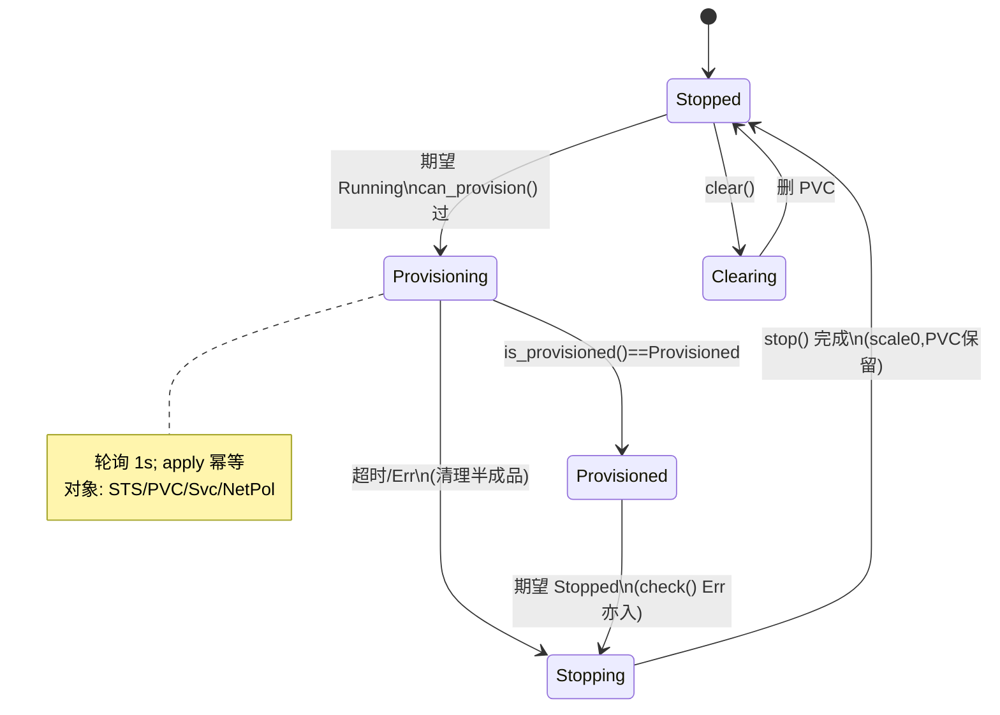

# ADR: Kubernetes Pipeline Runner（P1-006）

- 状态：**已接受（2026-10-21 评审通过）**；P1-007 已按本 ADR 完成执行器分发接线，P1-009 按本 ADR 实现垂直切片
- 日期：2026-10-21
- 上下文：`self-hosted-enterprise-platform-plan.md` §5.1——在自有 K8s 上以 per-pipeline 资源隔离运行
  DBSP pipeline；无 Feldera license。
- 相关代码（本仓库 open-source 基线，可直接复核）：
  - `crates/pipeline-manager/src/runner/pipeline_executor.rs` —— `PipelineExecutor` trait、`ProvisionStatus`
  - `crates/pipeline-manager/src/runner/pipeline_automata.rs` —— 生命周期状态机、轮询周期、供给超时
  - `crates/pipeline-manager/src/runner/local_runner.rs:1038` —— `LocalRunner` 参考实现（`DEFAULT_PROVISIONING_TIMEOUT = 20s`）
  - `crates/pipeline-manager/src/all_in_one.rs:37,63,72,123` —— 执行器接线点（`augment_args` / `runner_config` / `runner_main::<E>`）
  - `crates/pipeline-manager/src/bin/pipeline-manager.rs:33` —— 入口 `run::<LocalRunner>`（分发开关所在处）
  - `crates/feldera-types/src/config.rs:794-812` —— 自定义 pipeline StatefulSet 模板与占位符文档
  - `crates/feldera-types/src/config.rs:2291-2343` —— `ResourceConfig`（`cpu_cores_min/max`、`memory_mb_min/max`、
    `storage_mb_min/max`、`autoscaling`、`storage_class`、`service_account_name`、`namespace`）
  - `crates/feldera-types/src/config.rs:1112,1314` —— `RuntimeConfig.provisioning_timeout_secs`（覆盖 runner 默认供给超时）

## 1. 背景与目标

开源仓库的 runner 只有一个 `LocalRunner`（`PipelineExecutor` 的实现），在 manager 进程内拉起 pipeline
二进制。企业版有 K8s runner（约 `crates/dbsp-enterprise` / `K8sRunner` 闭源），本仓库源码中**没有**
`KubernetesRunnerConfig` 结构（`crates/pipeline-manager/src/config.rs:1541` 仅有 `LocalRunnerConfig`）。

本 ADR 目标：给出从 `PipelineExecutor` trait 到 K8s 对象的**全生命周期映射表**，覆盖 trait 的**全部方法**
（DoD 硬性要求），并定义 StatefulSet/PVC/Service/NetworkPolicy 模板与 `{id}`/`{namespace}` 等占位符的
展开语义，作为 P1-007 实现与后续 per-pipeline 隔离、容灾的基础。

非目标：在线 scale-out（plan §5.6 明确砍掉）；license/计费；多租户网络策略细则（P1-014 以后）。

## 2. 概念映射：trait ↔ K8s

`PipelineAutomaton`（状态机，`pipeline_automata.rs`）只通过 `PipelineExecutor` 的 10 个方法 + 1 个常量与
runner 交互。K8s runner 的实现，是把每个 pipeline 变成一个**命名空间内的一组 K8s 对象**，对象名携带
`{id}`（pipeline 名字，即 `deployment` 对象名），使得对象可被幂等地 create/patch/delete，且 manager
重启后可从集群状态恢复（runner 无内存态，符合 trait 注释"no runtime state is needed"的要求）。

| PipelineExecutor 成员 | 语义（trait 注释） | LocalRunner 参考行为（现状） | K8sRunner 映射（本 ADR） |
|---|---|---|---|
| `type Config` | runner 独有配置 | `LocalRunnerConfig`（工作目录、coordinator 路径） | 新建 `KubernetesRunnerConfig`：kubeconfig 路径 / in-cluster 开关、镜像仓库、limit 阈值（对齐官方 chart `kubernetesRunner.*` 键）、模板 ConfigMap 引用（见 §5） |
| `DEFAULT_PROVISIONING_TIMEOUT` | `Provisioning` 阶段超时默认值 | `20s`（local_runner.rs:1042） | 建议 `180s`：镜像拉取（ImagePullBackOff 重试窗口）+ PVC 绑定 + pod Ready 常态需要；可被 `runtime_config.provisioning_timeout_secs` 覆盖 |
| `new(...)` | 构造 runner + 启动拒登日志 | 空闲 | 持有 kube client（kube-rs `Client`），in-cluster 优先、kubeconfig 兜底；仅构造，不做对象操作 |
| `generate_storage_config()` | 生成 pipeline 存储配置（storage 开启时） | `pipeline-<id>/storage` 本地目录 | 返回 `StorageConfig { path: "/var/lib/feldera/storage" }`（PVC 挂载点）；PVC 生命周期见 §4 |
| `can_provision(...)` | 检查能否管理（create/retrieve/update/delete）计算与存储资源；失败保证 `stop()`/`clear()` 可清理 | 恒 `Ok(())` | 验证：namespace 可访问（`get` 权限）、模板 ConfigMap 存在（若引用）、配额检查；失败返回 `ManagerError` |
| `provision(deployment_initial, bootstrap_config, deployment_id, deployment_config, program_info, program_binary_url, program_info_url, program_version, runtime_config, is_gen2)` | 幂等、尽量非阻塞地创建计算(±存储)资源；之后用 `is_provisioned()` 轮询完成 | 写工作目录、下载二进制、spawn 进程、写 port 文件 | **apply 对象集合**（§4）：StatefulSet + PVC + Service + NetworkPolicy（+ Secret 用 `program_info` 边计算）；`is_gen2=true` 时忽略 `program_binary_url`、启动 Gen-2 引擎容器 |
| `is_provisioned()` | 校验供给是否完成；仅不可恢复错误返回 Err | 检查 port 文件存在 → `Provisioned { location }`，否则 `Ongoing { details }` | 轮询 StatefulSet `.status.readyReplicas >= 1` 且 pipeline HTTP（port 8080 或配置端口）可探活 → `Provisioned { location: "http://<service>.<ns>.svc:<port>" }`；`ImagePullBackOff`/`CrashLoopBackOff`/`PodUnschedulable`→ 判为**不可恢复错误**返回 Err（进自动机错误语义）；其余 `Ongoing { details: 事件摘要 }` |
| `check()` | 健康检查（Provisioned 期）；Err=不可恢复 | 探活 HTTP `/healthz` | 探活 pipeline Service；pod 状态异常（OOMKilled、backoff 且超过超时）→ Err；`Ongoing` 不适用、返回 `Provisioned` 细节 JSON |
| `stop()` | 缩到零/释放计算资源，**保留存储**；幂等、阻塞至完成 | kill 进程、保留目录 | **scale StatefulSet 到 0 + 保留 PVC**（存储不删）；不删 NetworkPolicy（配 `{}` 空规则为隔离仍生效，P1-014 细化）；幂等：已 0/不存在则 no-op |
| `clear()` | 清空存储资源；幂等、阻塞 | 删本地存储目录 | 删除 PVC（先 scale 0 已由 `stop()` 保证）→ 等 PV 释放；不可恢复错误才 Err |
| —（自动机轮询周期） | `pipeline_automata.rs:185-200` | `Stopped` 2.5s / `Provisioning` 1s / `Provisioned` 2.5s / `Stopping` 1s | 沿用，不改自动机；K8s API 客户端自带 watch/retry，轮询开销可忽略 |

**补充语义（自动机侧，非 K8sRunner 可改）**：
- `ProvisionStatus::Ongoing { details }` 周期上报（`RemainProvisioningUpdateDetails`，节流 `DETAILS_UPDATE_MIN_INTERVAL`），
  详情为 pod 事件摘要 + 状态 JSON。
- 供给超时（`automata.rs:1503`）：`deployment_resources_status_since` 起算，超过
  `provisioning_timeout_secs.unwrap_or(E::DEFAULT_PROVISIONING_TIMEOUT)` → `TransitionToStopping { error: AutomatonProvisioningTimeout }`。
  即 K8sRunner 设定合理默认（180s）+ 允许 per-pipeline 覆盖，超时后 stop 清理并留错误详情。

## 3. 生命周期图（ResourcesStatus × K8s 对象）

对象集合（一次 `provision()` 幂等 apply）：
1. **Namespace**（`enable_per_pipeline_namespace=true` 时创建；否则复用控制面 ns，见 §5）
2. **StatefulSet** `feldera-pipeline-{id}`：容器 = `{pipeline_executor_image}`；挂载 PVC + Secret；env 注入
   `FELDERA_*`；resource limits 来自 `ResourceConfig`（§4 映射）
3. **PVC** `feldera-pipeline-{id}-storage`
4. **Service**（ClusterIP）`feldera-pipeline-{id}`，端口 8080
5. **NetworkPolicy**（默认 deny + 仅允许 manager 与 pipeline 间端口，P1-014 前先放行同 ns）

## 4. 模板与占位符展开（`feldera-types/config.rs:794-812` 契约）

占位符由 runner 在 apply 前做**纯字符串替换**（官方模板文档明示，模板必须是合法 YAML 经替换后才解析）：

| 占位符 | 替换值 | 使用位置 |
|---|---|---|
| `{id}` | pipeline Kubernetes 名（`feldera-pipeline-<deployment name>`） | 对象名、labels（幂等键） |
| `{namespace}` | pipeline 运行 namespace（`runtime_config.resources.namespace` 或控制面 ns） | metadata.namespace、DNS 名 |
| `{pipeline_executor_image}` | runner 配置的镜像 | StatefulSet 容器 image |
| `{binary_ref}` | `program_binary_url`（或 gen2 时为空） | args `--program-binary-url` |
| `{program_info_ref}` | `program_info_url` | args `--program-info-url` |
| `{pipeline_storage_path}` | PVC 挂载路径（默认 `/var/lib/feldera/storage`） | volumeMounts |
| `{storage_class_name}` | `ResourceConfig.storage_class`（空则省略 storageClassName） | PVC |
| `{deployment_id}` | `deployment_id` UUID | annotations（审计） |
| `{deployment_initial}` | `deployment_initial`（provisioning/running…） | args `--deployment-initial` |
| `{bootstrap_policy}` | `bootstrap_config.policy`（若有） | args `--bootstrap-policy` |

`ResourceConfig → Pod/资源映射`（`config.rs:2291`）：

| ResourceConfig 字段 | K8s 映射 |
|---|---|
| `cpu_cores_min/max` | container `resources.requests/limits.cpu`（K8s quantity 格式，min/max 分别做 request/limit） |
| `memory_mb_min/max` | `resources.requests/limits.memory`（`<N>Mi`） |
| `storage_mb_min/max` | PVC `requests.storage`；`storage_mb_min` 设置时启用基于 `StorageAutoscalingConfig` 的扩容策略（扩展 PVC `spec.resources.requests.storage`） |
| `storage_class` | PVC `storageClassName` |
| `service_account_name` | StatefulSet `spec.template.spec.serviceAccountName` |
| `namespace` | 对象 namespace；`discover_namespace_from_runtime_config_json`（`pipeline_executor.rs:127`）反序列化前取用，孤儿防护（同名测试） |

## 5. 配置面（P1-007 实现项）

OSS 无 `KubernetesRunnerConfig`；官方 enterprise chart 的 `kubernetesRunner.*` 键（`enablePerPipelineNamespace`、
`allowCustomPipelineTemplate`、`lowerLimitMemoryMegabyte`…，见 `charts/feldera` 当前 values 骨架）在 OSS
manager 里**无对应读取代码**是本 ADR 确认的差距。P1-007 已落地（代码位置见各条）：

- 执行器选择：`FELDERA_RUNNER`（`local` 默认 / `kubernetes`，别名 `k8s`；大小写与空白不敏感），解析在
  `crates/pipeline-manager/src/runner/selection.rs`，分发在 `crates/pipeline-manager/src/bin/pipeline-manager.rs`。
- `KubernetesRunnerConfig`（`crates/pipeline-manager/src/config.rs`）：
  - `--kubernetes-runner-kubeconfig`（`FELDERA_KUBERNETES_RUNNER_KUBECONFIG`）：kubeconfig 路径；不设则走
    in-cluster service account。
  - `--kubernetes-runner-namespace`（`FELDERA_KUBERNETES_RUNNER_NAMESPACE`，默认 `feldera`）。
  - `--kubernetes-runner-pipeline-executor-image`（`FELDERA_KUBERNETES_RUNNER_PIPELINE_EXECUTOR_IMAGE`）：
    pipeline pod 镜像；`can_provision` 缺失时报 `RunnerConfigError`。
  - `--kubernetes-runner-per-pipeline-namespace`（默认 false）：对应 chart 的 `enablePerPipelineNamespace`。
  - `--kubernetes-runner-allow-kubernetes-env-prefix`（默认 false）：受控开关，见下条。
- `pipeline_env` 受控开关（`crates/pipeline-manager/src/pipeline_env.rs`）：`validate_pipeline_env` 保持原语义
  （默认拒绝 `KUBERNETES_` 前缀，local_runner 行为零回归），新增 `validate_pipeline_env_with(env, allow_kubernetes_prefix)`
  与进程级开关 `set_allow_kubernetes_env_prefix`，manager 以 Kubernetes runner 启动时按配置设置，使 API 侧校验一致。
- `KubernetesRunner` 骨架（`crates/pipeline-manager/src/runner/kubernetes_runner.rs`）：
  `DEFAULT_PROVISIONING_TIMEOUT = 180s`（决策 1）；`can_provision` 校验镜像配置；`provision`/`is_provisioned`/
  `check`/`stop`/`clear` 显式返回"未实现"错误（各用对应 `RunnerError` 变体），避免 manager 看似健康而 pipeline 永不启动。

后续切片的配置键（`image_pull_policy`、`limits_*` 越界阈值、`template_configmap`）在 P1-009/P1-011 随实现一起加入，
P1-007 不预置未使用的配置项。

## 6. 决策与开放问题

1. **默认供给超时 180s**（vs LocalRunner 20s）：镜像拉取/背压窗口的必然差异；per-pipeline 可覆盖。**已决策**。
2. **`stop()` 保留 PVC**：符合同步企业版"scales up/down without losing state"契约；`clear()` 才删。**已决策**。
3. **gen2（`is_gen2=true`）**：不产生二进制、容器直接跑引擎镜像；`{binary_ref}` 替换为空并传入空参。**已决策**。
4. **NetworkPolicy 默认 deny 细节**：本 ADR 只定义模板与占位符，规则体在 P1-014 多租户工单落地。**待实现**。
5. **监控/事件上报格式**：`details` 取 `kubectl get events` 摘要（Reason/Message 截断 200 字符），避免 DB 膨胀。**开放**。
6. **孤儿对象保护**：apply 幂等 + `{id}` 定名，重启可恢复；namespace 删除需先删对象（孤儿风险由 P1-014 的
   租户 ns 生命周期覆盖）。

## 7. DoD 自检（评审证据）

- [x] 字段映射表覆盖 trait **全部** 10 方法 + `type Config` + `DEFAULT_PROVISIONING_TIMEOUT`（§2 表逐行）
- [x] `ProvisionStatus` 轮询语义（Ongoing/Provisioned/不可恢复 Err）与超时路径（§2/§3）
- [x] StatefulSet/PVC/Service/NetworkPolicy 模板 + 全部 9 个占位符（§4 表，来源 `config.rs:794-812` 契约）
- [x] 配置差距确认（`KubernetesRunnerConfig` 缺失）与 P1-007 实现清单（§5）
- [x] P1-007 接线落地：`FELDERA_RUNNER` 选择、`KubernetesRunnerConfig`、`KUBERNETES_` 前缀受控开关、
  `KubernetesRunner` 骨架（§5）
- [ ] **评审通过**：待用户/评审者确认后置为 Accepted
